# GTAC VC Tools

GTAC VC Tools is the shop app for laying out a cell, trimming the SSCC61x framework, drawing the EtherCAT trunk, and generating fixture and weld outputs.

Designed and built by Brandon, Dave, Mark, Mikey, and Richard, the guy that is never here.

Home has two sections. Robot holds the weld tools. PLC holds the TwinCAT tools. Project Board, PM Hub, GitHub, Wiki, and Local Server sit in the row underneath.

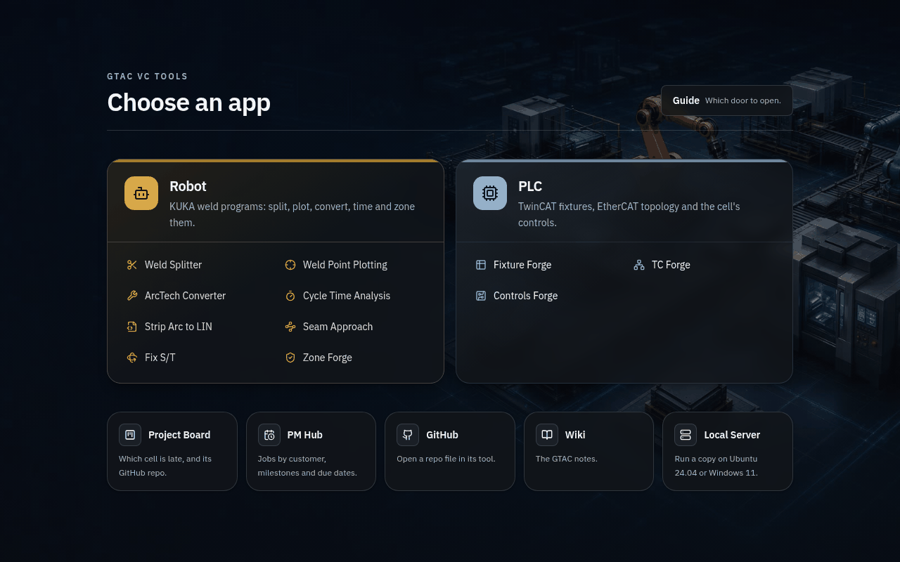

- [Home](#home)
- [Inside a tool](#inside-a-tool)
- [Robot](#robot)
  - [Weld Splitter](#weld-splitter)
  - [Weld Point Plotting](#weld-point-plotting)
  - [ArcTech Converter](#arctech-converter)
  - [Cycle Time Analysis](#cycle-time-analysis)
  - [Strip Arc to LIN](#strip-arc-to-lin)
  - [Seam Approach](#seam-approach)
  - [Fix S/T](#fix-st)
  - [Zone Forge](#zone-forge)
- [PLC](#plc)
  - [Fixture Forge](#fixture-forge)
  - [TC Forge](#tc-forge)
  - [Controls Forge](#controls-forge)
- [Project Board](#project-board)
- [PM Hub](#pm-hub)
- [GitHub](#github)
- [Wiki](#wiki)
- [Local Server](#local-server)
- [Framework trim](#framework-trim)

## Home

- **Robot** (weld theme): Weld Splitter, Weld Point Plotting, ArcTech Converter, Cycle Time Analysis, Strip Arc to LIN, Seam Approach, Fix S/T, and Zone Forge. Click the Robot heading to open Weld Splitter.
- **PLC** (TwinCAT theme): Fixture Forge, TC Forge, and Controls Forge. Click the PLC heading to open Fixture Forge.
- **Bottom row**: Project Board, PM Hub, GitHub, Wiki, and Local Server.

The top of Home reads GTAC VC Tools and the heading Choose an app, with nothing else under it. Each tool name is a link, so it can open in a new tab. Guide at the top right says which tool fits the job. Click it again to close it.

Every screen shares one look: the shop photo shows clearly behind dark, see-through panels with bright text, and one colour code. Blue marks the main button (Refresh, Choose CSV, Connect GitHub, Download, Run, Convert, Create page…) and the option that is picked (Guide turns blue while it is open, Local Server gets a blue outline). Teal is finished work, amber needs attention, and red is for errors and the most urgent states (overdue and Urgent in PM Hub, At risk on the Project Board); everything else is grey. Each status also says what it is in words, and At risk, Complete and Needs review have an icon too. Inside the Robot and PLC tools the section's own colour (amber for Robot, steel blue for PLC) still marks the open tool, tab and picked toggles, and the keyboard focus outline follows it; on Home and PM Hub the focus outline is blue. While a tool opens, a small panel with a spinner says Opening and the tool's name. If a tool cannot load or hits a problem, the same panel says so, with Try again in blue, Reload page and Back to apps.

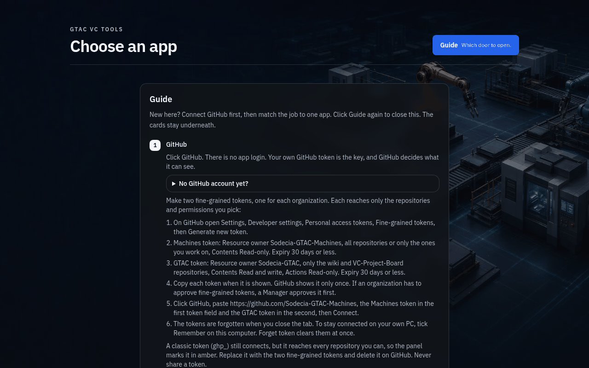

Opening the weld app lands on Weld Splitter.

A bookmark such as ?app=weld, ?app=fixture, ?app=network, ?app=controls, ?app=zones, or ?app=board opens that tool. ?app=weld without a screen opens Weld Splitter.

## Inside a tool

Every tool has the same header. Home and the section drop-down are on the left. Change log, Clear saved work, GitHub, and Wiki are on the right.

The drop-down shows the section and the tool you are in, such as ROBOT, Weld Splitter. Hover over it, or click or tap it, to switch to another tool in that section. Go to PLC or Go to Robot at the bottom jumps to the other section. The keyboard works too: Enter or the down arrow opens it, the arrows move, and Escape closes it.

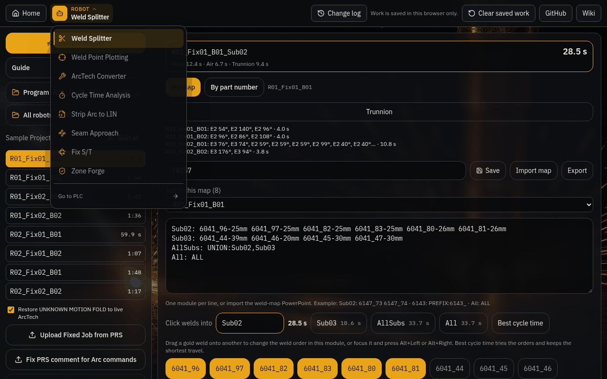

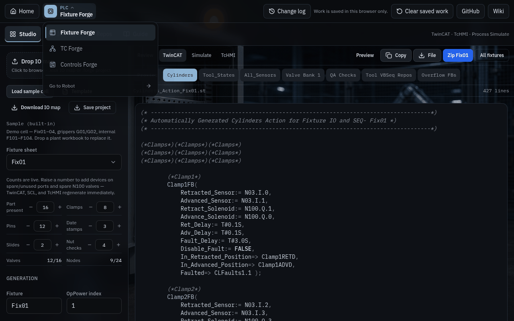

- **Guide**: Weld tools, Zone Forge, Fixture Forge, TC Forge, and Controls Forge each have their own Guide. Click it again to close it.
- **Sample data**: The weld tools have Sample Project on the left. It loads the Front Bumper programs and that weld map. Click it again to clear it. Loading your own .src or zip turns the sample off. On Weld Point Plotting the sample also shows a made-up part. Zone Forge has its own Sample Project, a made-up two-robot cell. Fixture Forge has Load sample cell and Controls Forge has Load sample. The weld and Zone Forge samples are made up, not a real job.
- **Change log**: the clock button lists what changed in that tool and when: Robot tools, Fixture Forge, Project Board, PM Hub and Zone Forge each have one. It opens without a password.
- **Saved work**: Work is saved in this browser only. It is still there after a refresh, but not on another PC or in another browser. Clear saved work resets that tool in this browser and cannot be undone.

## Robot

KUKA weld programs: split, plot, convert, time, and zone them. A weld program from GitHub (src, dat, zip, or pptx) opens in Weld Splitter.

The weld tools share the panel on the left (Sample Project, Guide, Program, and All robots) and one saved work. Weld Point Plotting does not use Program or All robots. Seam Approach and Fix S/T each have their own Program box on their page.

### Weld Splitter

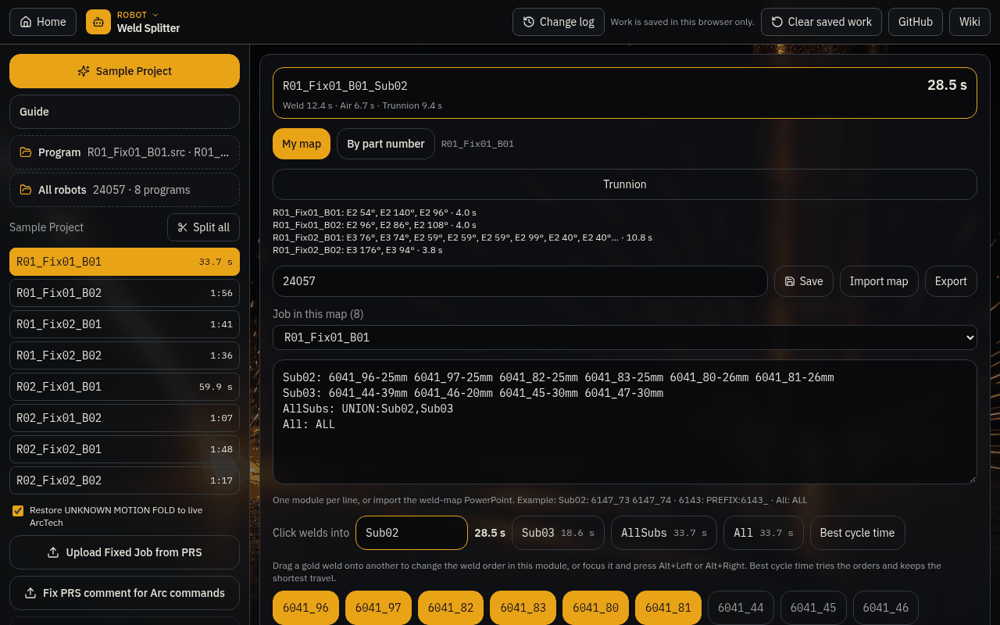

Group welds into modules and download the KUKA programs.

Drop the program .src and the positions .dat on Program. Both can go in at once. All robots takes one or more controller backup zips. If a zip has Sodecia/Weld_Jobs, only the programs in that folder are used. While a zip unpacks, a line under All robots shows how far it is, with Cancel. A zip can be up to 250 MB with up to 20,000 files and 512 MB unpacked; a bigger one, or one that unpacks to far more than its size (a zip bomb), is refused with a message, and the programs already loaded stay as they were.

An arc-weld seam is the run of LIN and CIRC points that share a seam name ending _ls1, _ls2 or just _1, _2, such as C1X_100_200_L_1_ls1, C9_X100_200_L_R3_1_ls2 or C9_X100_200_L_R3_1_6. All its points are one weld, and the approach before it goes with it; a point of one seam never moves to the next, also when two seams follow each other with no PTP between them.

My map is one module per line. Import map reads a weld-map PowerPoint or a JSON file you exported earlier. By part number skips the map and makes one module per weld family, plus All. Split job, then Download zip. Best cycle time keeps the order with the shortest travel between welds. Click Trunnion when the cell has a KP1 or KP3.

After you fix points in simulation, Upload Fixed Job from PRS takes the Process Simulate file that still has the UNKNOWN MOTION FOLD lines, plus its .dat. Fix PRS comment for Arc commands turns the commented arc lines back into ArcTech. Jobs Ready for Robot saves the corrected files.

### Weld Point Plotting

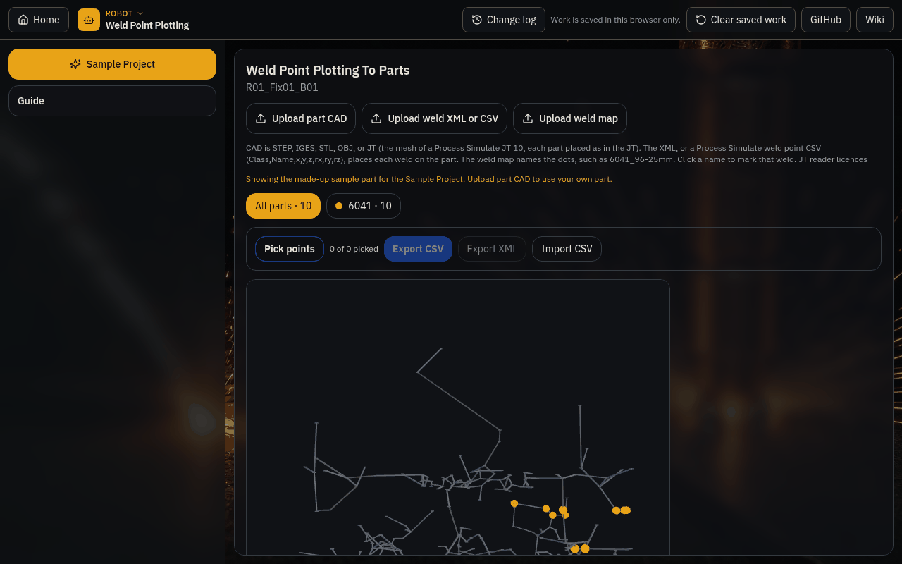

Plot the weld points onto the part each weld belongs to. With Sample Project on, a made-up frame shows with the sample weld points on it, and a line says it is the sample part; your own upload replaces it. Upload part CAD takes a STEP, IGES, STL, OBJ, or JT (see JT parts below). A Parasolid .prt or .x_t has to be exported as STEP first. Upload weld XML or CSV places each weld on the part; it takes a weld XML or a Process Simulate weld point CSV (Class,Name,x,y,z,rx,ry,rz). Upload weld map is the PowerPoint that labels each dot. Click a name in the list to mark that weld. Drag to rotate.

The part is saved in this browser for the program that is loaded, so each project keeps its own part. It comes back after a reload, and a note under the buttons says so. A part file can be up to 200 MB. A bigger file is refused with a message, and a part saved earlier is kept. Like other saved work, it is not on another PC or in another browser.

If you uploaded a part before Oct 29, upload it again once.

The weld dots show only on a part that has loaded. A weld XML on its own does not show dots until the part is loaded.

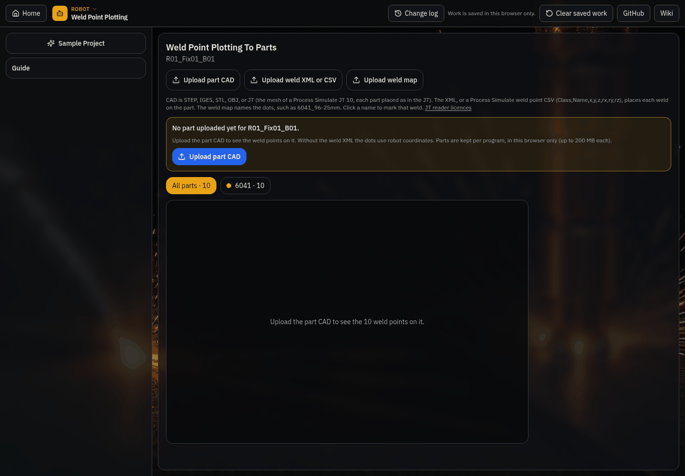

- **No part:** the plot area says Upload the part CAD to see the N weld points on it. The banner says what is missing: Load a program first, No part uploaded yet for the program, or that a part uploaded before is no longer in this browser (or was too big to keep), with an Upload part CAD button. Without the weld XML it adds that the dots use robot coordinates. If a part is saved for another project, a Use button offers it.
- **Loading:** the plot area says Loading the saved part… until the part is read. A STEP or IGES file is read in the background with a progress line (Downloading the STEP reader… the first time, then Reading the STEP file…) and a Cancel button, so the page stays usable. The reader stops on its own if a file takes far too long (2 minutes plus 6 seconds per MB, at most 15 minutes). In a browser that cannot read in the background, only parts up to 8 MB are read; use an up-to-date Edge, Chrome or Firefox for bigger ones.
- **The part could not be shown:** the plot area stays empty and the banner gives the reason, with no dots. Try a STEP (AP214 or AP242) or STL export and upload it again. A file that does not load is not saved, so a good part saved earlier is kept.
- **Weld points are not on the part:** their X Y Z come from the robot program. Upload the weld XML to place them on the part.

The view frames the part and the weld points together. Clear saved work also clears the saved parts. STEP and IGES parts load on the Local Server too.

#### Pick points and export a Process Simulate CSV

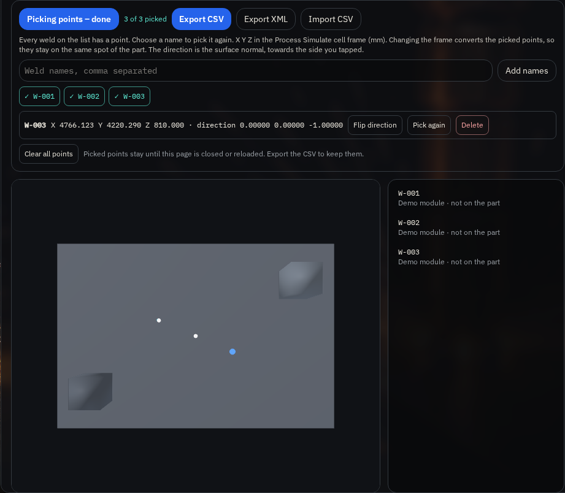

When the part has loaded, Pick points lets you place weld points by tapping the part, for example when there is a weld map but no weld XML. The names come from the weld map, or type them (comma separated) and press Add names. With no names at all, each tap adds the next W-001, W-002…

- The name to place is highlighted in blue. Tap the part where it goes; the next weld without a point is chosen by itself. Names with a point turn teal with a tick, and the count says how many are picked.
- Each point keeps X Y Z (mm) where the part was tapped and a direction: the unit surface normal there, turned towards the side you tapped from. Picked points show as white dots with a cyan arrow, apart from the coloured weld dots.
- Tap a name to see its values. Flip direction turns the arrow round, Pick again replaces the point with the next tap, and Delete removes it. Clear all points asks for a second tap.
- Export CSV saves the points in the Process Simulate weld point format: the header Class,Name,x,y,z,rx,ry,rz, one PmWeldPoint row per point, X Y Z with 3 decimals and the direction with 5. Export XML saves the same points as a weld XML (without the direction).
- For a JT, X Y Z are in the frame shown (the Process Simulate cell frame unless Assembly frame is chosen). Changing the frame converts the picked points with the JT's top-level placement, so they stay on the same spot of the part and the export always matches the frame on screen. For any other CAD they are in the part file's own coordinates.
- Import CSV reads an exported CSV (or one from Process Simulate in the same format) back as picked points to carry on with. A CSV has no frame in it, so it is read in the frame shown at the time; a Process Simulate CSV is in the cell frame.
- Picked points stay until the page is closed or reloaded; export the CSV to keep them. They never leave the browser.

The direction is the surface normal of the part where you tapped. It is not the torch or gun direction; check it in Process Simulate.

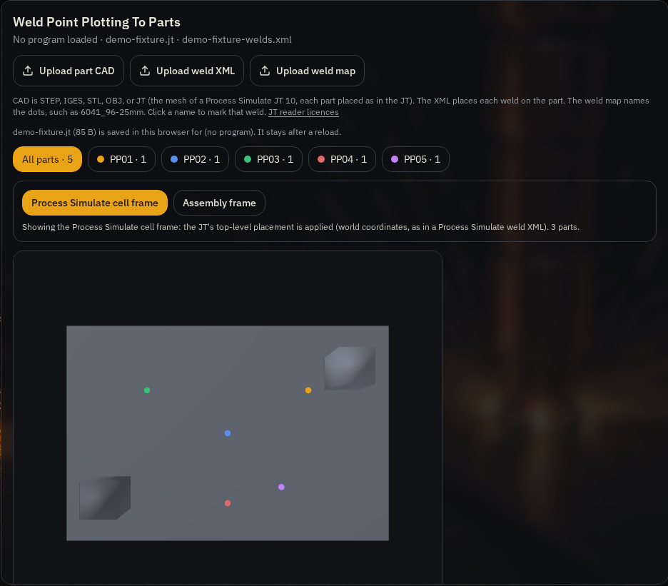

A JT is read in the browser; the JT reader (about 10 MB) downloads only when a JT is opened, so the first one takes a few seconds. Process Simulate JT 10 meshes are supported. Each part in the JT shows as its own part, with its name as stored in the JT and its placement from the JT. A part used more than once shows once per use, each in its own place.

A Process Simulate JT also stores where the whole assembly sits in the cell (the top-level placement). Two buttons choose the frame:

- **Process Simulate cell frame** (the default): the top-level placement is applied, so the part sits where it is in the cell. Use it with a weld XML from Process Simulate, whose points are in cell (world) coordinates.
- **Assembly frame:** the top-level placement is left out, so the part sits at the assembly's own origin.

The line under the buttons says which frame is shown and how many parts there are, or that both frames are the same when the JT has no top-level placement. The browser remembers the choice. If the weld points are not on the part, the hint says to try the other frame.

A JT that has only exact geometry and no mesh shows a red message: This JT has no mesh – export STEP from NX, Teamcenter or Process Simulate. JT files from NX, Teamcenter or older JT versions are not tested; if one fails, export STEP or STL instead. The JT reader licences (JTReader and SharpCompress, MIT) open from the JT reader licences link under the buttons.

### ArcTech Converter

Turn a Process Simulate download into ArcTech. Load one job, or Upload jobs for a zip or several .src files. UNKNOWN MOTION FOLD comes back as ArcOn, ArcSwi, and ArcOff. The .dat is not changed.

Before Download, each program's changed lines show, removed in red and added in green, with the count under Download, such as 320 lines added. Open a program's section to see its lines; long lists show the first 30 changes and Show all.

### Cycle Time Analysis

Seam and travel time from the weld map and the programs. Upload weld map and choose the PowerPoint. The seam time uses the millimetres on each weld label, such as 6041_96-25mm, divided by the weld speed. Load the program and the .dat on the left for a second table that adds travel between the points. Download analysis saves the tables as an Excel file. Blending and acceleration are not included, so a real cycle runs a bit longer.

### Strip Arc to LIN

Turn ArcOn, ArcOff, and ArcSwi into LIN moves. Load one .src and .dat, or Upload jobs zip for several. ArcOn and ArcOff become a fine LIN at 0.01 m/s. ArcSwi stays a LIN with C_DIS. A comment such as ; was ARCON WDAT1 marks each line so the arc can be taught again on the robot. The .dat files are not changed.

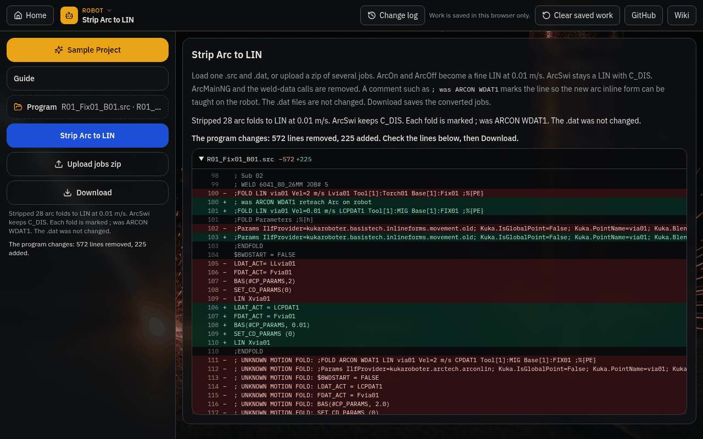

Before Download, each program's changed lines show, removed in red and added in green, and the count shows under Download, such as 572 lines removed, 225 added. If nothing changes it says so: Download would give back the same files.

### Seam Approach

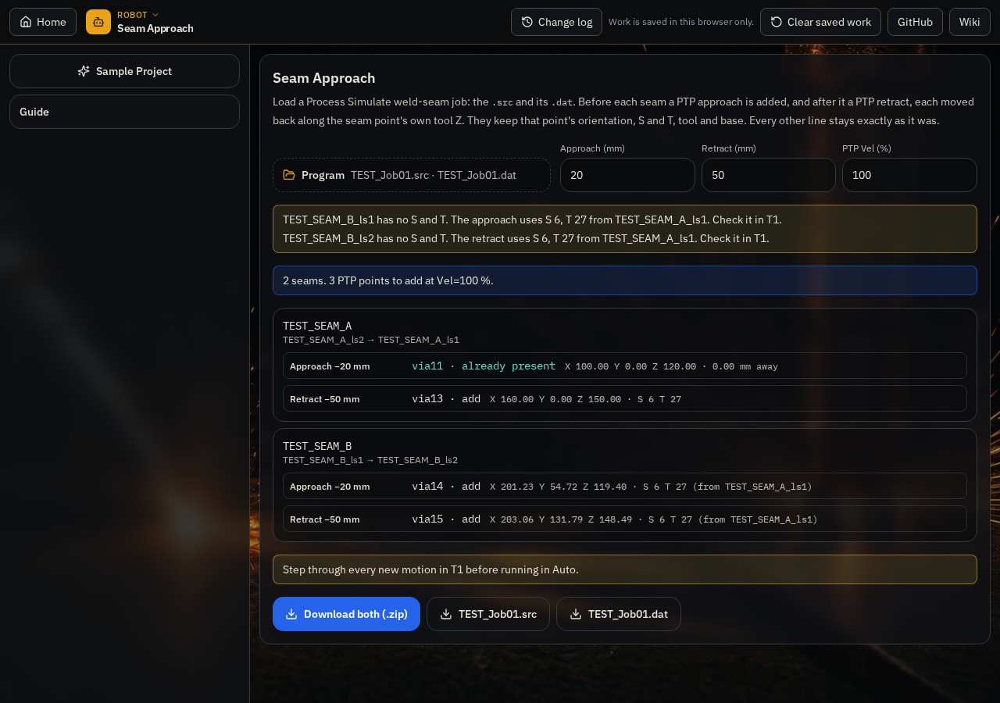

Add an approach before and a retract after each weld seam of a Process Simulate job, each a PTP or a LIN, and, when asked, a PTP HOME as the first and the last move. Choose or drop the .src and its .dat together on Program on the page. A seam is a run of LIN points and arcs (CIRC) whose names share a start and end _ls1, _ls2 or just _1, _2 and so on; the two endings may mix in one seam (SEAM_1_ls5 then SEAM_1_6). The program's own order is kept, so a seam can run ls2 then ls1, or ls6 down to ls1. An arc counts by its end point (CIRC Xaux, Xend), and its auxiliary point is part of the seam too. Names must match exactly up to the number: SEAM_L_1_ls1 and SEAM_1_1_ls1 are two seams. A PTP, a point without a number at the end, or a different name ends a seam. A run named only _1, _2 needs at least two moves, so a lone LIN such as AIR_1 is not a seam.

- The approach goes before the first point of the seam and the retract after its last point, never between the points of a seam or between an arc's auxiliary and end points. The approach is the first seam point moved back 20 mm along its own tool Z, and the retract is the last seam point (the end point when the seam ends on an arc) moved back 50 mm, as the frame product point : {X 0,Y 0,Z -20,A 0,B 0,C 0}. Both are PTP at 100 % by default. Approach move and Retract move each choose PTP or LIN, on their own; a LIN goes at LIN Vel (m/s, 1 by default). Approach (mm), Retract (mm), PTP Vel (%) and LIN Vel (m/s) change them.
- Each new point keeps the seam point's orientation, S and T, external axes, FDAT (tool, base and IPO_FRAME, #TCP for an external TCP) and the Tool and Base text of its fold. The fold is a full PTP or LIN inline form in the style of the program's own folds, including CONT and C_DIS. A PTP takes the PDAT of the program's PTP before the seam; a LIN takes the LDAT of the seam's own LIN (or the nearest LIN), with the same fields the program uses.
- A seam that starts with an arc gets no approach, because an arc starts from the point before it; an amber note says so, and the preview shows not added. Its retract is added as usual.
- When a seam point has no S and T, the nearest earlier point that has them is used and an amber note says which. With none at all, the point has no S and T and the note says so.
- New points are named from the next free viaNNN after the highest one in the files. Their E6POS, FDAT and PDAT (LDAT for a LIN) go at the end of the .dat, before ENDDAT, in program order. KRL names are at most 24 characters.
- When the point just before a seam is already within 0.5 mm of the approach, or the point just after it is within 0.5 mm of the retract, the preview shows already present (in teal) and nothing is added there. Running the tool again on its own output adds nothing.
- The preview lists each seam, its points, and each approach and retract with its name, X Y Z, and S and T. Every other line downloads byte for byte with the same line endings (CRLF stays CRLF). Download both (.zip) saves the pair; the two buttons beside it save the .src or the .dat with its own file name.
- A .dat that belongs to another program (its DEFDAT does not match the DEF), a seam point missing from the .dat, or folds that do not close stop the change with a red note, and nothing is saved.
- PTP HOME (XHOME) as the first move and PTP HOME (XHOME) as the last move are two tick boxes, off by default. Each adds the standard KUKA PTP HOME inline form (PDAT_ACT=PDEFAULT, FDAT_ACT=FHOME, $H_POS=XHOME, PTP XHOME) before the program's first move or after its last, at PTP Vel. XHOME, FHOME and PDEFAULT are the robot's own from $config.dat, so nothing is added to the .dat. When the first or last move already goes to HOME (PTP XHOME, PTP XHOME1, PTP $H_POS, or a fold such as PTP HOME or PTP AXIS : XHOME), nothing is added there and a teal note says so.
- Step through every new motion in T1 before running in Auto.

### Fix S/T

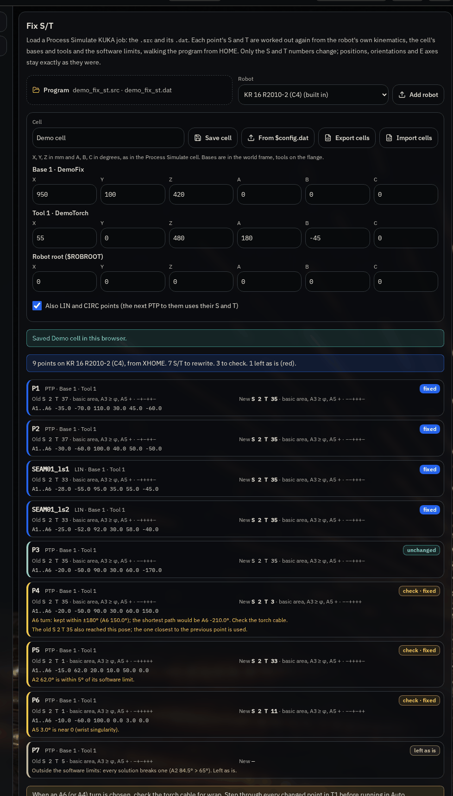

Work out the S (Status) and T (Turn) of every point of a Process Simulate KUKA job again from the robot's own kinematics, so each PTP reaches its point with joints inside the software limits. Use it when a job stops at a PTP with a software-limit or axis-limit error although the point itself is reachable. Choose or drop the .src and its .dat together on Program on the page.

- **Robot**: two robots are built in. The KR 16 R2010-2 (C4), the default: its arm lengths, axis directions and the software limits A1 ±185°, A2 −185° to 65°, A3 −138° to 175°, A4 ±350°, A5 ±130°, A6 ±350°. The KR 6 R2010-2 arc HW (C5), a hollow-wrist arc robot: KUKA's motion range A1 ±170°, A2 −185° to 65°, A3 −122° to 178°, A4 ±165°, A5 ±140°, A6 ±350°. The robot last chosen is kept in this browser. **Add robot** takes another robot's $machine.dat and $robcor.dat and keeps the robot in this browser. Only standard central-wrist 6-axis KUKA arms are accepted ($KINCLASS #STANDARD, $MAIN_AXIS #NR, $WRIST_AXIS #ZEH, six rotary axes); anything else is refused with the reason, and so is a $robcor.dat from another robot. Machine data of a built-in model (from Add robot or an archive zip) chooses the built-in robot instead of saving a copy.
- **Archive (.zip)**: one zip brings the robot, its cell frames and its programs. Use a KRC Archive all from the robot, or WorkVisual generated code (or an exported project) zipped with its KRC folder. In any folder and any letter case it finds KRC/R1/Mada/$machine.dat and $robcor.dat (the robot), KRC/R1/System/$config.dat (bases, tools and the global HOME points) and every .src with a .dat of the same name (outside Mada, System and TP). The list under the zip shows what it found in teal, what is missing in amber (no $machine.dat, no $robcor.dat, no $config.dat, no programs) and in red why a robot cannot be added, with the same reasons as Add robot. **Save robot** keeps the robot in this browser under its model name or the name you type, **Use its bases, tools and HOME** fills the cell, and **Open program** loads the chosen pair, so no separate uploads are needed. When the zip holds more than one robot (R1 and R2) or more than one controller, choose the robot first. The zip is checked against the app's zip limits (file size, number of files, unpacked size and zip bombs), and only the robot files and the chosen program are unpacked. A backup of only the weld jobs shows "Machine data missing" and still lists its programs.
- **WorkVisual projects**: a .wvs file is a database the app does not read. Dropping one shows what to do instead: in WorkVisual, generate the code for the controller (or export the project), zip the folder that holds KRC and drop that zip.

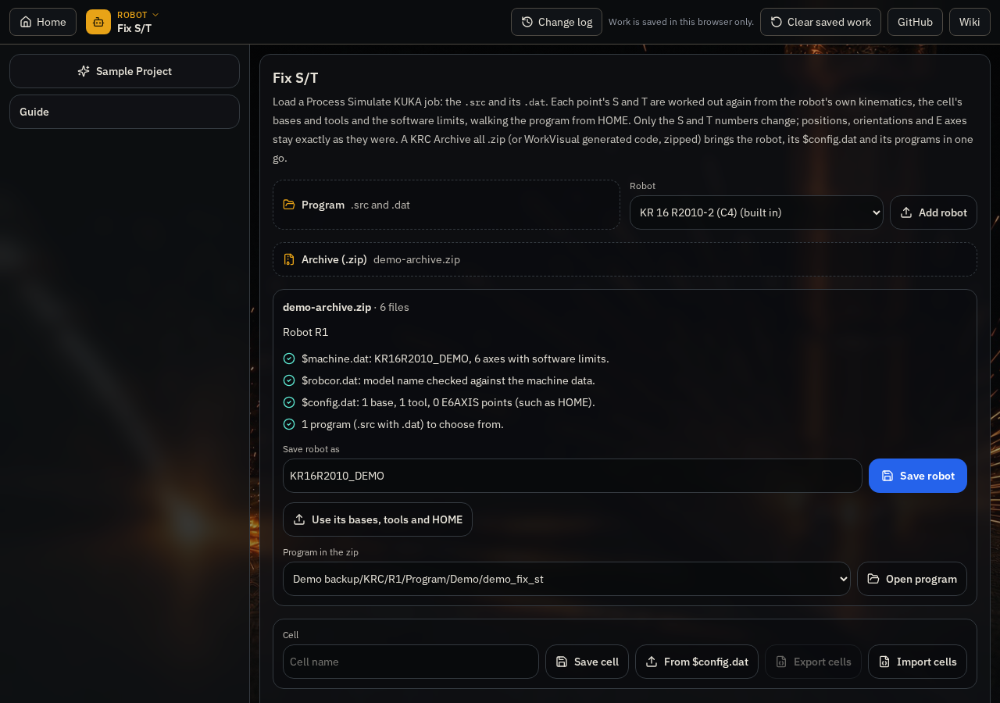

- **Bases and tools**: for each BASE_NO and TOOL_NO the program uses, type X, Y, Z, A, B and C as in the Process Simulate cell (bases in the world frame, tools on the flange), or fill them with **From $config.dat**, which also reads the global HOME points. Base 0 is the world and tool 0 the flange. Robot root is $ROBROOT, zero when the robot is the world. **Save cell** keeps the values under the cell name in this browser; **Export cells** and **Import cells** move them as a JSON file. A file that is not a Fix S/T cell file, or has a frame that is not six numbers, imports nothing.
- **How S and T are chosen**: the program is walked in order from its HOME (an E6AXIS point in the .dat or from $config.dat). For each point every joint solution inside the software limits is found. The point's own S is kept, and of those solutions the one closest to the previous joints is used; A4 and A6 stay within ±180° whenever a solution allows. Its S and T replace the old ones, unless Keep taught S/T (below) keeps a taught S and T that already reach the point. When no solution keeps the S, a wrist flip with the same arm configuration is used and marked; when not even that exists, the point is left as is. LIN and CIRC points are included unless the checkbox is cleared, because the next PTP to them uses their S and T.
- **Keep taught S/T** (on unless cleared; this browser remembers the choice): a point whose taught S and T already reach it inside the software limits keeps them, reads **kept** in teal with "Kept – taught S/T reaches this pose", and the walk goes on from those joints. Only S and T that do not reach the point (or are not numbers the robot can use there) change. With it off, every point gets the solution closest to the previous joints, and a taught S and T that also worked is marked amber.
- **CIRC auxiliary points**: an auxiliary point without an FDAT of its own uses the base and tool of its CIRC end point (inline folds, plain CIRC and SCIRC). The controller does not use an auxiliary point's S and T, so they are never rewritten. The point reads **aux · reachable** when a solution inside the limits reaches it, red only when none does, and grey (not checked) when neither it nor its end point has a base and tool.

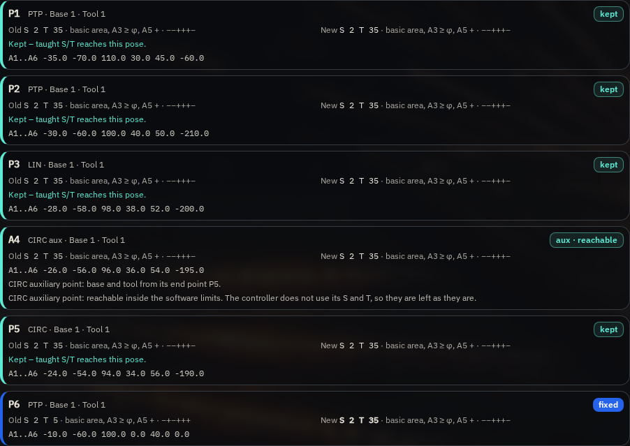

- **Preview**: each point shows its motion, base and tool, the old and new S and T with the bits spelled out (basic area or overhead, A3 against φ, A5 sign, and the sign of A1 to A6), the joint angles, and its state. Teal is unchanged, blue is fixed, amber is fixed or kept but worth a look (a joint within 5° of its limit, A5 near 0, an A4 or A6 turn other than the shortest path, a wrist flip, or an old S and T that also worked), and red is left as is (out of reach, outside the limits, a base or tool with no values, or a fixed tool, IPO_FRAME #TCP).
- **Download**: only the S and T numbers inside the existing E6POS lines change, in the form they were written. Positions, orientations, E axes and every other byte of the .dat stay as they were, with the same line endings, and the .src is not changed. The blue button saves the .dat with its own name; Both (.zip) saves the unchanged .src with it. A .dat that belongs to another program, or a point without X, Y, Z, A, B and C, stops the change with a red note.
- External axes do not move the bases here: bases are fixed in the world. A base that rides on a positioner is not worked out from E1 to E6.
- When an A6 turn is chosen, check the torch cable for wrap. Step through every changed point in T1 before running in Auto.

### Zone Forge

Fill in the interference-zone handshakes. Drop the KUKA programs and their .dat files, with the same name for both, such as R01_Fix01.src and R01_Fix01.dat. Process Simulate marks the last point before an interference volume and the first point after it.

Pick PLC bits or OLP sync. With PLC bits, assign one bit per pair of robots. 106 is the first pair, and robot interference uses 106 to 112. Bit 105 is the trunnion, or table, turn. Change a number to match the zone on the fixture, check What gets added, then Download the programs.

Each download is named for the style you picked: R01_Fix01.src comes back as R01_Fix01_plc.src or R01_Fix01_olp.src, with its .dat to match. A name that already ends in _plc or _olp is rewritten for the style, so converting again does not stack the endings. DEF, DEFDAT and the Program header inside the files are changed to the new name.

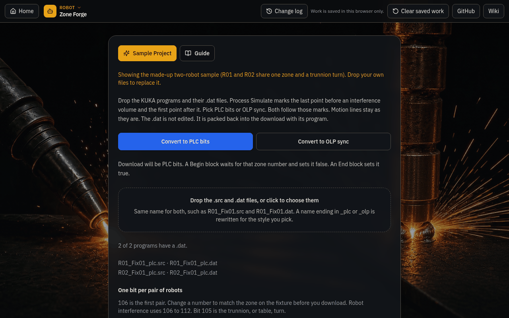

Sample Project loads a made-up two-robot cell (R01_Fix01 and R02_Fix01) to try it; dropping your own programs replaces it. Guide lists the steps. The trunnion settings show only when the programs have trunnion comments; otherwise a line says there are none. When the programs already have every handshake, it says Nothing to change. Download would give back the same files.

## PLC

TwinCAT fixtures, EtherCAT topology, and the cell's controls.

### Fixture Forge

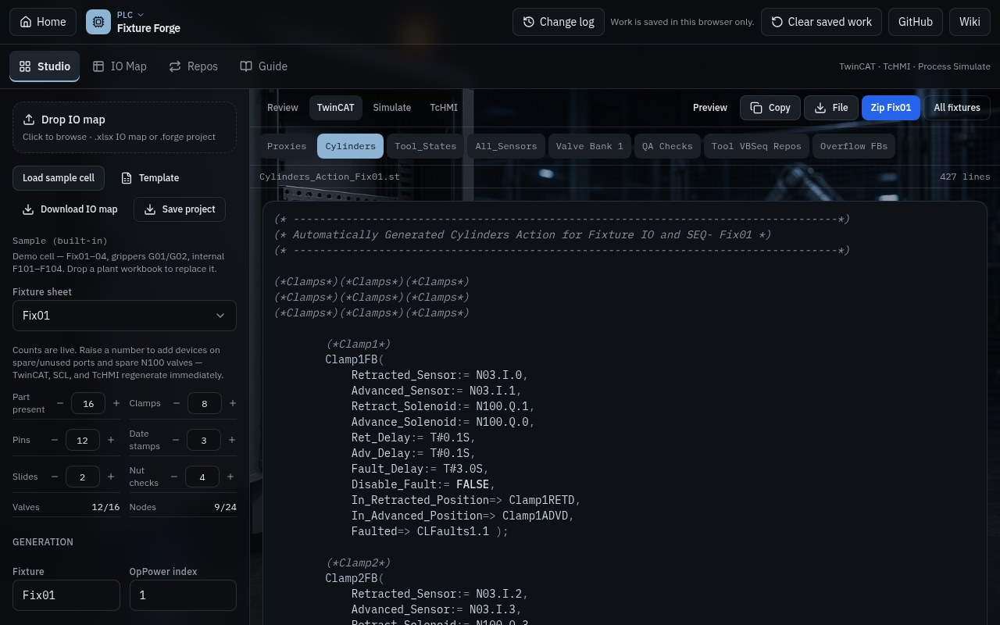

Open this when you have a fixture IO workbook. It writes the TwinCAT actions, the TcHMI screens, and the Process Simulate sequence from that sheet.

Drop the Excel map, or click Drop IO map and browse. Pick the fixture sheet. Copy the output into the matching POU or editor.

A workbook (.xlsx or .xlsm) or a saved .forge project can be up to 128 MB. Inside it, at most 10,000 files, 128 MB for any one file once unpacked, and 512 MB unpacked in total; a file that unpacks to far more than its packed size (a zip bomb) is refused too. A refused file shows the reason in the workbook panel, ending "Nothing was changed.", and the workbook that was open stays as it was. A real IO map is far under these limits; if a workbook with many large pictures is refused, save a copy without the pictures or sheets you do not need and drop that.

While a workbook or project opens, a line at the top of Fixture Forge says what it is doing: Reading the file, Opening project, Unpacking N of M files, then Reading sheets N of M, with a bar that follows those counts. Cancel stops the import and says "Import cancelled. Nothing was changed."; the workbook that was open keeps its sheets, name and settings. Dropping another file or clicking Load sample cell during an import replaces it, and the earlier one never changes the open workbook. Cancel takes effect between files and sheets, so a very large sheet finishes the step it is on first.

Workbook columns the generator reads:

- J / K — node (N01–N24) and port 0–7
- L / M — address (N01.I.0) and the description of use
- AC / AD — sequence of operation: step number and the action (Close, Open, Adv, Ret, grouped by model)

Sequence packs as part present, then clamps, pins, slides, and nut checks. Each new device type starts on port 0 of the next node. If a group ends on ports 0–6, the rest of that node is spare. Unused hardware is tagged Node Not Used.

A nut check with only one input is a sensor: it is labeled Nut Check# and comes after the other part presents as the next Part_Present. A nut check with home and work inputs and both valve solenoids stays a cylinder. Anything else is left for you to name. A Slide # Lock on one solenoid, with the other side spare, has no feedback and turns on before that slide moves.

On the TcHMI page, the Layout tab is where devices are placed on the fixture picture: Sample fixture or Upload image, then click where each arrow points. On a phone the text sits above the buttons. For the code files, Preview and Source switch between the drawn screen and the code. The layout can take the whole window. The left panel and the top band slide away. Click the arrow to bring them back. A screen you added can be deleted. The objects that were placed on it clear, so they can be placed again.

A fixture workbook from GitHub opens in this app.

### TC Forge

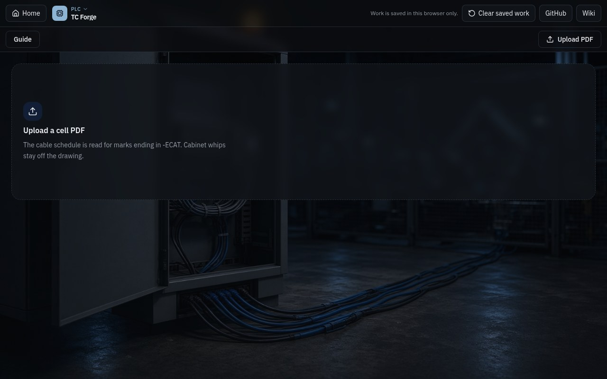

Open this when you already have the cable schedule, from Controls Forge or from a cell PDF. It draws the trunk, starting at IC01, and the cables that leave it.

Upload the cell PDF, or drop it anywhere on the page. The topology always starts at IC01. Download the drawing when you need a copy.

### Controls Forge

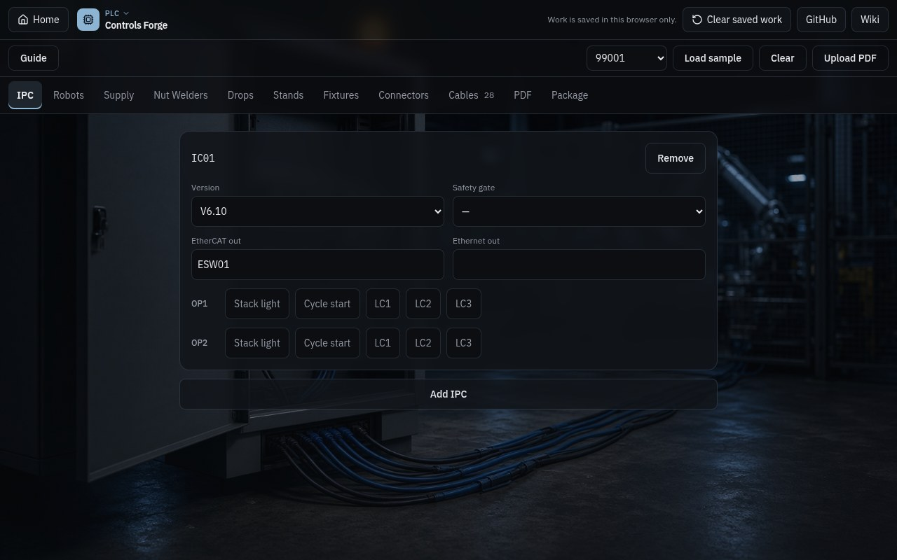

Open this when you are laying out the cell. Cabinets, robots, options, and cables live here. Type a length and the cable part number shows up. The Package tab writes the keep list that trims the SSCC61x framework down to this cell.

#### Start a cell

Pick a project in the sample list and click Load sample. That fills the tabs from a real cell. Upload PDF does the same from a cable schedule: marks that end in -ECAT become the devices, the links, and the lengths. A PDF dropped anywhere on the tool does the same as Upload PDF. With no devices yet, the page shows a card to drop or pick the PDF, and the PDF tab shows it until the cell has an EtherCAT cable. Clear puts the form back to empty.

If the PDF or the sample has no cell number on the end, the app asks for it before the serial is finished.

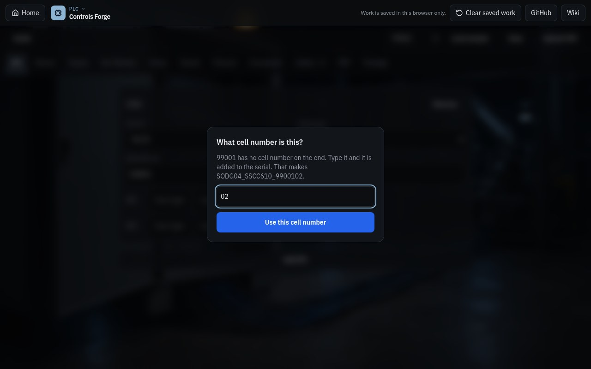

#### Tabs

IPC holds the version, the safety gate, and where EtherCAT and Ethernet leave. Operator rows turn on the stack light, cycle start, and light curtains. Robots take the cabinet, the arm, the welder, and the reamer. Supply, nut welders, drops, stands, and fixtures are the rest of the chain. Connectors lists the plug on each cabinet. EtherCAT out is the next device.

#### Cables

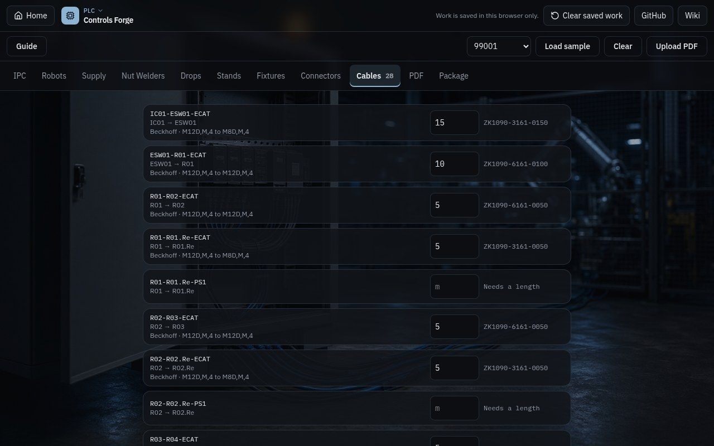

Cables lists every link the tabs describe. The connectors are already known from the devices. Type the length in meters and the part number comes from the lookup, including the maker and the connectors on the cable. No length yet means the cable is still waiting.

#### Topology PDF

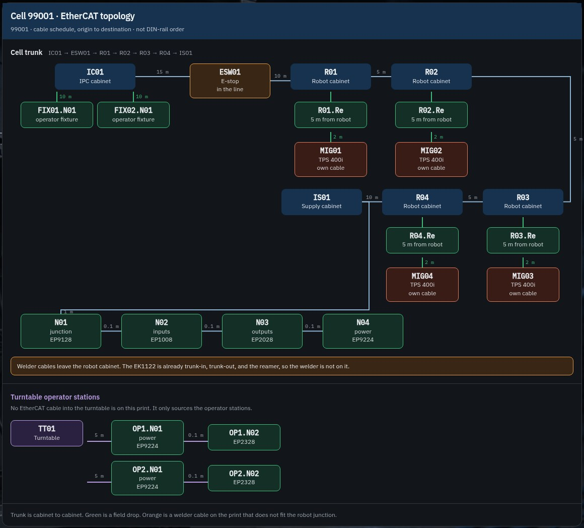
<!-- topology-drawing-v4 -->
PDF draws the EtherCAT trunk, starting at IC01, with the drops beside it. When the row hits the right side it continues on the left as another row. Download PDF puts that drawing on the first page and the cable list after it. TC Forge reads the marks that end in -ECAT.

A cell PDF from GitHub can open here or in TC Forge.

## Project Board

Which cell is late, who is loaded, and its GitHub repo. Red (At risk) is late or has less time left than work left. Amber (Tight) is due within 14 days. On track (grey) still has room. A finished job shows Complete in teal.

The board reads the VC_Project_Board list from the private VC-Project-Board repository on GitHub, using the GitHub token connected in this browser. Refresh reads it again. If GitHub cannot be read, the last copy stays on screen, and Drop export under More works too.

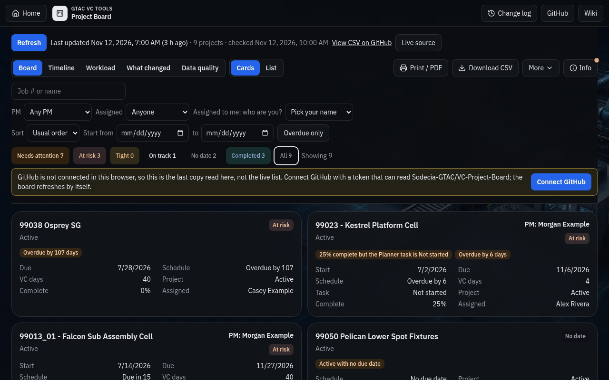

The SharePoint export runs on weekdays at 7 AM, 12 PM and 4 PM Eastern but only changes the board CSV on GitHub when the SharePoint list changed, so an old CSV is normal. The note under Last updated goes by when the export last ran, read from the export's GitHub Actions runs in VC-Project-Board: "Export checked weekdays at 7 AM, 12 PM and 4 PM Eastern · last run 7:00 AM · no changes since Nov 4, 4:00 PM" in grey. It turns into an amber warning, "… The SharePoint export may have stopped.", only when the newest export run failed, or when the last scheduled weekday run (7 AM, 12 PM or 4 PM Eastern) plus 2 hours has passed with no successful run since it. Evenings, nights and weekends are covered by the last weekday run, so they never show the warning, and the clock changes in spring and fall are handled. When it does show, check the Power Automate flow and the repository's Actions tab. If your token cannot read the Actions runs (see [Token](#token)), there is never a warning: after 4 working hours without a change (Monday to Friday, 7:00 to 18:00) a grey note says when the data last changed and that this is normal if nobody edited the list. On a phone the note shows under the header without opening Info. A dropped export shows no note.

When you come back to the board's browser tab, it checks GitHub (at most every 2 minutes) for a newer board CSV. If there is one, a blue line says New board data is available, with Refresh and Not now. Nothing reloads by itself.

Without a GitHub token, an amber line under the header says the board is not connected and whether it is showing the last copy read in this browser, with a Connect GitHub button. Once the token is saved the board reads the live list by itself. While a dropped export is showing, the line says so, with Back to live.

Search (job number or name, placeholder Job # or name), PM, Assigned and Assigned to me narrow the jobs. The chips are Needs attention, At risk, Tight, On track, No date, Completed and All.

After those come the shared list filters, the same on the Board, PM Hub Projects and Fixture reviews:
- **Sort**: Usual order (the board's own order), Latest (newest start date first), Due date (soonest due first) or Oldest (oldest start date first). Jobs without that date go last.
- **Start from / to**: only jobs whose start date is in the range (both days included). A job with no start date is left out while a range is set.
- **Overdue only**: open jobs past their due date, the same jobs that carry the Overdue attention flag.

These are kept in this browser with the other board filters, Clear filters resets them, and the CSV and printout summary lists them. On a phone they sit under the Filters button with PM and Assigned.

### Screens

- **Board**: cards, or a compact list with one row per job.
- **Timeline**: a bar per job from Start to Due, filled to % complete, with a line for today. Group by none, PM or assigned person. Jobs with no due date are not on it.
- **Workload** (?view=workload): VC days still to do for the next 8 weeks, per person or per PM. Capacity is 5 days a week. Over 5 is red, 4 to 5 is amber. Late jobs are in an Overdue column before the first week, and Total includes them. A week under 1 day shows as a faint dot. It counts in Total and can be clicked. Click a number to list that week's jobs. Jobs with no due date or no VC days cannot be placed; the count links to Data quality.
- **What changed**: new and removed jobs, moved dates, status and % changes, and jobs newly overdue or at risk, since your last visit, or 7 or 30 days ago.
- **Data quality** (?view=quality): every job with a data problem, grouped by PM, each with a Fix in Planner or Fix in SharePoint line. It shrinks as the list is cleaned up.

### Job details

Click a job name on a card, list row, timeline bar, Data quality entry or Workload week. A panel opens with every field, the Plan, GitHub and SharePoint links, the job's data problems with the fix, and its last changes. The address gets ?job=. Close, Esc or Back returns to the view. On a phone it opens full screen.

The repository name, Save repository and Open GitHub are only in this panel. A card shows a GitHub button when the job has a repository.

When the PM Hub customer list can be read, the panel also has read-only Business unit and Customer lines. Business unit shows the job's Sodecia business unit with its code, division and country; Customer shows the external customer with its small logo and contact. Each name opens that record in PM Hub, and Not set links to the job in PM Hub to pick one.

### Buttons

- **Print / PDF** prints the current view. Save as PDF works. The header names the view, the filters and the data time.
- **Download CSV** saves the jobs shown, with the columns the board shows.
- **More** holds SharePoint list, Drop export and Drop OneNote. Drop export takes a newer CSV or Excel export. Drop OneNote updates the fixture reviews. Dropping a file anywhere on the board works too. A file over 100 MB is refused. An Excel export is checked while it unpacks, with the same limits as other zips (up to 20,000 files and 512 MB unpacked); one that unpacks to far more than its size (a zip bomb) is refused with a message, and the board keeps what it showed.
- **Info** holds the notes about where the data comes from, the fixture reviews, and GitHub not being connected. A dot on Info means there is a notice.

## PM Hub

For the production managers. Open PM Hub on Home, next to Project Board, or go to ?app=pmhub. It uses the same jobs and the same GitHub token as the Project Board.

The line under the tabs says when the board CSV was saved. The same data note as on the Project Board shows under it: when the weekday export last ran (7 AM, 12 PM and 4 PM Eastern), amber only if the export failed or the last scheduled weekday run is more than 2 hours overdue. Coming back to the tab offers New board data is available with Refresh, as on the board.

On a phone, the tabs wrap onto two rows, and the status line under the tabs and the Customers search each get their own full-width row.

The screen tab that is open is blue. Buttons look the same on every screen: grey, with the main one blue (Add customer, Save, Copy, Connect GitHub). The status filters get a blue outline when picked. In Projects each customer is a card with a shaded header showing its open, overdue (red), due soon (amber) and done (teal) counts, and the jobs sit in even rows under a Job heading lined up with the timeline. Customers is a table with the job counts right-aligned and overdue jobs as a red tag; Fixture reviews has shaded column heads, grey stages in progress, teal Done and Approved, and amber Needs review.

### Projects

Jobs grouped by customer, with No customer set last. Each job shows its business unit (the Sodecia business unit's code, or No business unit) and its customer, each with its own Assign or Change button, then status, Planner priority, PM, due date, days left or late, % complete, a small start-to-due bar with milestone markers, and the next milestone. The priority comes from PlannerPriority in the board CSV and shows as a coloured tag: Urgent (red), Important (amber), Medium (blue) or Low (grey); a job with no priority has no tag. % complete comes from PercentComplete and shows as a short green bar with the number, the same value as on the Project Board card. Filter by PM, customer (the Customer list has the customers first and the Sodecia business units in their own group; picking a business unit shows its jobs; at the end, No customer set, No business unit set, and Customer or business unit missing), Priority (Any priority, the priorities the jobs have, most urgent first, and No priority), search (job number or name) and status (Open, Overdue, Due soon, At risk, No date, Completed, All). Due soon can be 7, 14 or 30 days. The status chip counts follow the PM, customer, priority and search filters. The shared list filters follow the status chips: Sort (Usual order, Latest and Oldest by start date, Due date soonest first, plus Priority with Urgent first and jobs without a priority last, and % complete with the most complete first; ties keep the board's order), Start from / to, and Overdue only, which turns on the Overdue status (open jobs past their due date or with an overdue milestone) and back to Open when turned off. They also apply to Timeline and Milestones, and are kept in this browser with the other PM Hub filters.

Click a job to open its details. The top of the details shows the status, PM, people, priority tag, % complete bar and schedule, then the job's Business unit and Customer, each with its own picker. Start and Due come from SharePoint; change those dates there. Add milestone adds your own, such as Design review, Fixture buy-off or Ship. Tick a milestone when it is done. The PM note is also here. Open in Project Board opens the same job on the board.

When the customer list has been read and open jobs are missing a customer or a business unit, an amber button next to the Customer filter says how many ("3 open jobs are missing a customer or business unit"). Click it to list just those jobs, then use Assign on each.

### Timeline

Looks and works like the board's Timeline. Group by Customer, PM or None. PM milestones show as diamonds on the bars: red overdue, amber due soon, filled done.

### Milestones

Every milestone in the filters, by date: Overdue, Due soon, Upcoming, No date, and Done (folded).

### Customers

The shared customer list holds two kinds of record:

- **Customers**: the external customers we build for.
- **Business units**: Sodecia's own business units and holdings (internal). Each has its code (for example SGTAC), country, division (Corporate, Automotive, Safety & Mobility, Technology, Access & Authorization) and level (BU, Regional Holding, Division Holding or Sectorial Holding).

Every job has one business unit and one customer. They are picked separately: choosing a business unit never changes the job's customer, and the other way round.

The list shows Customers and Business units in their own groups, with an All / Customers / Business units filter; search also finds a code, country or division. Each card or row shows its logo on a small white tile, or its initials. Add customer, or click one to edit it: Type (Customer or Sodecia business unit), name, short code, for a business unit its country, division and level, main contact (name, email, phone) and notes. The edit panel shows the logo next to the name. A record is deactivated rather than deleted.

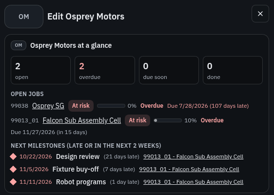

The top of the panel is the customer (or business unit) at a glance: its logo, how many jobs are open, overdue, due soon and done, the open jobs (late first, then by due date) with status, priority, % complete and due date, and the next milestones that are late or due in the next 2 weeks. Click a job to open its details; Back returns to the customer. A link to a customer (?view=customers&customer=) opens it filled in, even before the list has loaded. Delete is only offered when it has no jobs.

Link jobs to a customer or a business unit in three ways:

- pick the jobs from the list;
- by job number. A base number covers every job with it, and a full number covers that one job;
- by keyword in the job name or machine description.

A picked job wins over a job number, and a job number wins over a keyword. Customers and business units are worked out separately, so the same job number can link a job to one customer and one business unit. A job that matches two customers, or two business units, shows an amber Also matches warning. Fix it in one of them.

Each job in PM Hub also has a Business unit picker and a Customer picker. Assign or change either one for this job only or all jobs with that number, or clear it. The Business unit picker lists the active business units by division and searches name, code, country and division; the Customer picker can also make a new customer. A long customer name or business-unit code ends in … on the job, with Inactive still shown, and wraps onto a second line in the Customers list.

The list is saved to pm-hub/customers.json in the private Sodecia-GTAC/VC-Project-Board repository, so both PMs see the same list. Others see a change after Refresh. If someone else saved first, PM Hub reloads the list, keeps what you typed, and asks you to Save again.

### Shared milestones and notes

Milestones, ticks and PM notes are shared with the team in pm-hub/milestones.json in the same repository. They are saved a few seconds after a change, or with Save. If two people change the same job, PM Hub merges what it can and asks you to Save again. Without Write access they stay in this browser until they can be saved. If GitHub cannot be reached, the bar says so and they stay in this browser until GitHub answers. A job's details always show the newest saved PM note and milestone text, and closing the details or leaving a box without typing never changes them. Export saves them (and a copy of the customer list) to a file. Import puts them back.

When the Timeline has nothing to show, it says why (the No date filter, completed jobs hidden, or no dated jobs) with Show open jobs or Clear filters.

### Status emails

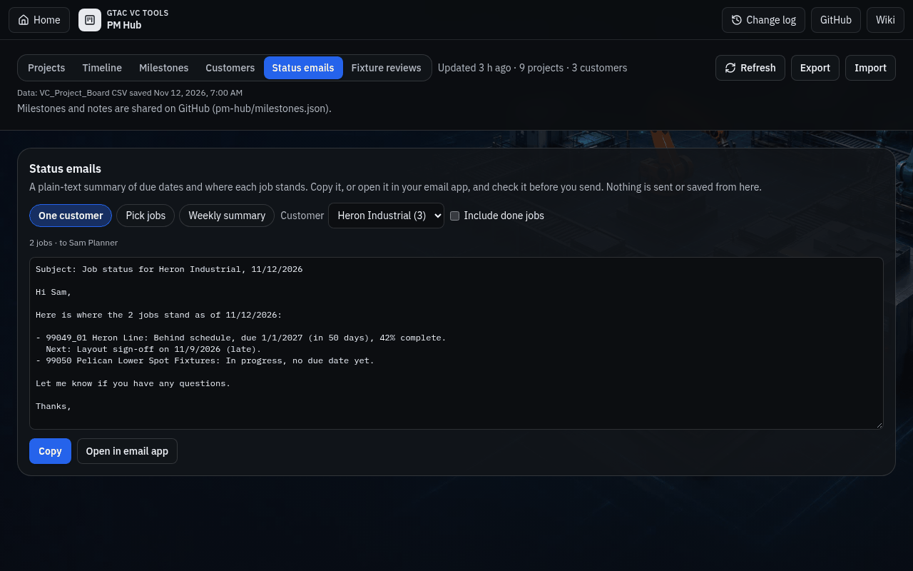

Status emails (?view=email) writes a plain-text update to send to a customer. Choose One customer and pick the customer, or Pick jobs and tick them. The text has a subject, a greeting with the customer's main contact, and one line per job: its status (Done, Behind schedule, At risk, Due soon or On track), due date, days left or late, % complete and the next milestone. Done jobs are left out unless Include done jobs is ticked.

Copy puts the text on the clipboard. Open in email app opens your own email program with it, addressed to the customer's contact email; a very long update opens with the subject only, so copy the text in. Read it before you send. Nothing is sent or saved from PM Hub.

#### Weekly summary

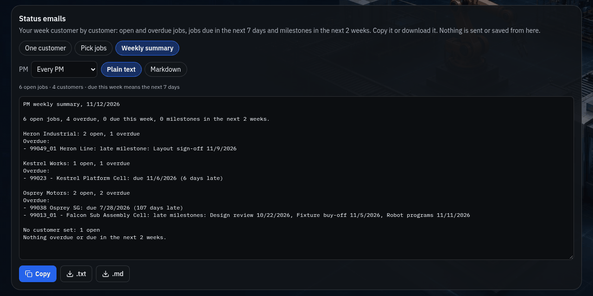

Weekly summary, the third choice in Status emails, is a short status for the PMs themselves, customer by customer: how many jobs are open, the overdue jobs and why (due date passed or a milestone late), the jobs due in the next 7 days, and the milestones in the next 2 weeks. Customers are in name order with No customer set last; done jobs are left out. Pick Every PM or one PM (your own name is picked when you chose it on the board), and Plain text or Markdown. Copy puts it on the clipboard; .txt and .md download it as pm-weekly-summary-<date>. It has no email link and contacts no one.

### Fixture reviews

Fixture reviews (?view=reviews) shows the team's fixture design review task list. It is read-only: the list lives in OneNote, on the page Review Task List-<year> in the Engineering Notebook (Engineering SharePoint site, Site Assets), and you edit it there.

On weekdays at 7 AM, 12 PM and 4 PM Eastern a Power Automate flow reads the table on that page and sends it to the private Sodecia-GTAC/VC-Project-Board repository in parts, because one message to GitHub can carry only 64 KB. A GitHub workflow there waits until every part has arrived, then reads the table and saves it as fixture-reviews/fixture_reviews.csv, only when something changed. Blank spacer rows are left out and dates are written as yyyy-mm-dd. The table needs its headers, in order: PROJECT-CELL, FIX #. TOOL#, CAD-REV, CAD REC'D ON, REVIEW STARTED BY, COMPLETED ON, SIM STARTED BY, COMPLETED ON, QUALITY STARTED BY, COMPLETED ON, SENT ON, NO. OF CUSTOMER REVIEWS, BUILD APPROVAL, and NOTES (optional). Each January the flow is pointed at the new year's tab and page.

On a computer screen (wider than 760 px) the list is one table with the columns Job, Fixture, CAD rev, CAD rec'd, CAD design review, Simulation and Next step, so every job's fixtures line up under the same headings; the heading row stays at the top while you scroll. Fixtures are grouped by project-cell in the same order as the page: a thin row with the project-cell and how many fixtures it has, then one row per fixture. The Fixture cell shows the fixture or tool number, a New revision tag when the row is highlighted green, the number of customer reviews and the notes.

The CAD design review (REVIEW STARTED BY / COMPLETED ON) and Simulation (SIM STARTED BY / COMPLETED ON) cells each show a short coloured tag with the initials, and the completed date after a ✓, in small text under it (for example "Done", "DB ✓ 9/9/2026"):
- **Not started** (outlined): no one has started it.
- **Started** (blue for CAD design review, purple for simulation): someone has started it and COMPLETED ON is still empty.
- **Done** (green): COMPLETED ON is filled, on or after CAD REC'D ON. When the build is approved (BUILD APPROVAL filled in, or the row highlighted orange), both CAD design review and Simulation show Done, with or without a date, and their dates are not compared with CAD REC'D ON.
- **Needs review** (orange): COMPLETED ON is older than CAD REC'D ON, so new CAD came in after the review and it has to be done again. The old initials and date stay under it in small text, for example "last: DB ✓ 9/9/2026". This applies to sent fixtures too, but not to approved ones. A review with no date, a row with no CAD rec'd date, or a date that is not a real date (for example TBD) is not compared.
- **Sent** (grey): the step was never completed on the page but the fixture has already been sent (SENT ON) and is not approved.

The Next step cell shows an orange **Needs review** tag, with which review needs doing again (CAD design review, Simulation, or both), when a review is older than CAD rec'd. Otherwise it shows what comes after the reviews in grey: Quality next (or Quality with the initials once started), Ready to send, Sent <date> or Approved <date>. It is empty while CAD design review or simulation is still open. There are no due dates or overdue tags on this tab.

On a phone or narrow window each fixture is a card instead, under its project-cell heading: the fixture name and tags, then CAD rev, CAD rec'd, CAD design review, Simulation and Next step as lined-up label and value pairs, with nothing scrolling sideways.

Search by job (project-cell), fixture, initials or notes, or pick a Status. Status goes by what the fixture is still waiting for: Needs review (a review older than CAD rec'd), Waiting on CAD review and Waiting on simulation while their COMPLETED ON is empty (a fixture waiting on both is in both), then Waiting on quality until quality's COMPLETED ON, Ready to send until SENT ON, Sent, and Approved (BUILD APPROVAL filled in or the row highlighted orange). Next to them: Sort (Usual order keeps the page's order; Latest and Oldest go by CAD rec'd on), CAD rec'd from / to, and Needs review only. These last for the visit only. A count shows how many fixtures match. Refresh reloads the list.

The line above the list says when the list was last saved, and that Power Automate saves it on weekdays at 7 AM, 12 PM and 4 PM Eastern. A grey note after 4 working hours without a change is normal when nobody edited the page; if someone did, the weekday Power Automate flow may have stopped.

If the flow could read the page but not the table, an amber box says "The last OneNote page could not be read, so the list below was not updated." with the reason, and the last good list stays below it. Usually a table header was renamed, removed or added, or the flow is reading the wrong page; put the header back and the next weekday run fixes it. "The flow sent no page content" means OneNote returned nothing or the parts could not be put back together. If a part never arrives, nothing changes until the next weekday run, and the leftover parts are cleared after a day. "No fixture review list yet" means the flow has not saved the list once.

### Access

You need your classic GitHub token (repo scope), authorized for SSO; see [GitHub](#github). To save customers, milestones and notes for everyone you also need Write access to VC-Project-Board. Ask Dave. Without it, the Customers tab is read-only and milestones stay in your browser.

## GitHub

GitHub is how a project gets into the app. The cell projects live in the organization https://github.com/Sodecia-GTAC-Machines.

There is no app login, name picker, or app 2FA code. Your own GitHub token is the key, and GitHub decides what it can see.

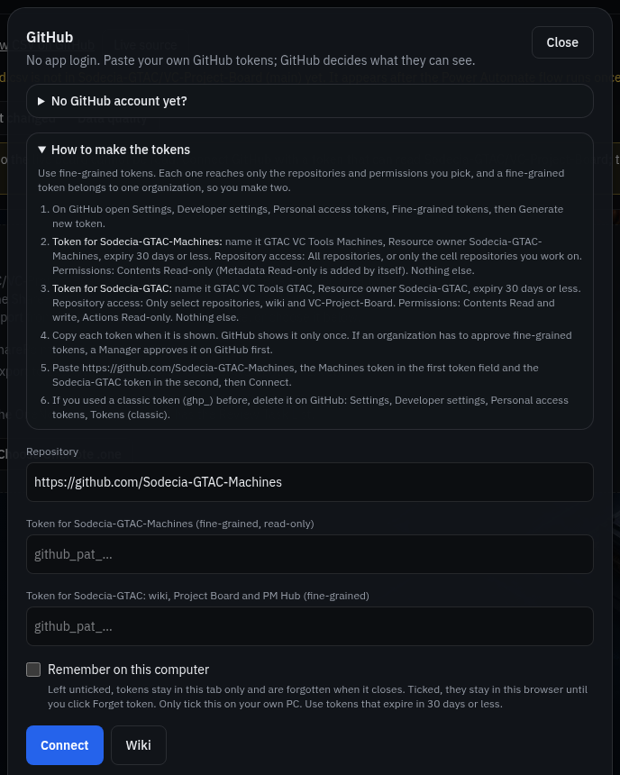

### No GitHub account yet?

1. Go to https://github.com/signup. Enter your work email, a password and a username your teammates will recognise, then solve the check.
2. Enter the code GitHub emails you to verify your email.
3. Turn on two-factor authentication: profile picture, Settings, Password and authentication, Enable two-factor authentication. The organizations may require it before you can join.
4. Send your GitHub username to Dave Bergman or your team lead and ask to be invited to the Sodecia-GTAC-Machines and Sodecia-GTAC organizations, and to the VC-Project-Board repository for the Project Board and PM Hub. Dave is an admin of both organizations, so the invitation comes from him or your team lead.
5. Accept each invitation from the email, or at https://github.com/orgs/Sodecia-GTAC-Machines/invitation and https://github.com/orgs/Sodecia-GTAC/invitation. Invitations expire after 7 days.
6. Then make your classic token below.

### Token

Make one classic token on GitHub. It covers Sodecia-GTAC-Machines and the Sodecia-GTAC wiki.

1. On GitHub open Settings, Developer settings, Personal access tokens, Tokens (classic), then Generate new token (classic).
2. Give it a note, such as GTAC VC Tools.
3. Tick only the repo scope.
4. Set an expiry of 30 days or less.
5. Click Generate token and copy it. The value is shown once. It starts with ghp_.
6. If an organization uses SSO, click Configure SSO next to the token and Authorize it for Sodecia-GTAC-Machines and Sodecia-GTAC.

The token can reach every repo you can, so keep it short-lived and never share it. A fine-grained token also works if you already use one; give it Contents: Read and write and Actions: Read on VC-Project-Board. Without Actions: Read the board and PM Hub still work, but the data note cannot tell whether the weekday export is running, so it only says when the data last changed.

### Connect

1. Click GitHub.
2. Paste https://github.com/Sodecia-GTAC-Machines in Repository. The address has to be real text in the box, not the gray hint.
3. Paste the token in GitHub token (classic).
4. Leave Wiki edit token empty. The same token is used for the wiki.
5. Optional: tick Remember on this computer, only on your own PC.
6. Click Connect.

Tokens stay only in that browser tab and are forgotten when the tab closes, unless you ticked Remember on this computer. Forget token clears them sooner. Forgetting a token, connecting a different one, or changing it in another tab clears every copy the app holds, so nothing is saved later with an old token.

What this browser keeps, in the panel, lists what stays on this PC: the token (only with Remember on this computer), the last board data and its history, the fixture reviews, the cached customer list, your tool work and your preferences. Forget token and clear this PC's cached data forgets the token and removes the board data, history, fixture reviews and cached customer list from this browser, then reloads. Tool work, PM Hub milestones and notes not yet saved to GitHub, and preferences stay. Use it on a shared PC.

If GitHub refuses the token, the panel says why. For SSO, authorize the token with Configure SSO.

### Projects

The organization link lists the repositories. Search filters that list. Download on a repository saves the whole repo as a zip.

Open a repository, then a folder. Software is listed with Documentation, Hardware, and the rest. Download on a file saves that file, including files that do not open in an app.

- A workbook opens in Fixture Forge.
- A cell PDF opens in Controls Forge or TC Forge.
- A weld program opens in Weld Splitter.

## Wiki

Wiki opens this repository, Sodecia-GTAC/wiki, full screen. It starts on the README table of contents. Folders still lists the drawers. Search needs at least two letters and matches notes and headings. Reading needs no token.

Close shuts the wiki and the GitHub panel. Escape closes only the wiki and shows the GitHub panel underneath; Escape again closes that. In the search box, the first Escape clears the search. While a page is being edited, Escape does nothing, so a stray key does not lose the edit. On a phone, Close stays at the top right and the search box has its own full-width row.

Edit opens the markdown for the page you are on. Save commits it to main. New page asks for a path, such as Instructions/New note.md, then commits that file; if a page with that name already exists, it says so and changes nothing. The path can have folders, spaces, brackets, & and dots inside a name. A path with an empty folder (// or a / at the start or end), a . or .. folder, a backslash, an encoded slash or a control character is refused with a message, and nothing is sent to GitHub, so a page always lands in the wiki. Cancel throws the change away.

If someone else saves the same page while you are editing, Save does not overwrite their change. A message says Someone else saved this page after you started editing, with Compare with their version, Copy my text and Open their version. Copy your text, open their version, and add your change to it.

Saving uses your classic GitHub token (repo scope), since the Wiki edit token field is left empty.

## Local Server

Run a copy on Ubuntu 24.04 Desktop or Windows 11. Local Server shows the download, vc-tools-local.zip, and the install steps for each system. It needs no password. A publish does not change a Local Server that is already running. Download the zip again and follow When the app changes.

The install script installs the exact package versions in the zip and builds the app; if a step fails it stops with a message. The start script serves that build at http://localhost:8080, and only that PC can open it. To let other PCs on the plant network open it, start it with bash start-ubuntu.sh --lan on Ubuntu, or add -Lan to the Windows start command. It has no sign-in and uses plain HTTP, so share it only on the plant network, allow port 8080 from the plant subnet only, and never open it to the internet or guest Wi-Fi. INSTALL.txt in the zip has the firewall steps.

## Framework trim

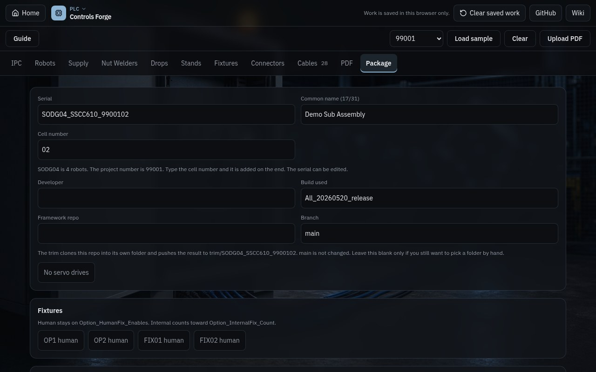

The Package tab in Controls Forge writes the keep list. The scripts trim a copy of the SSCC61x framework down to that cell. Robot count can change from job to job. Do not hard-code a cell size.

### Serial

The serial is filled in on Package. SODG and two digits is the robot count. SSCC610 is the framework. The project number plus the cell number is the end. Four robots on 26013 cell 02 becomes SODG04_SSCC610_2601302.

### One folder for the trim kit

On the PC, make one folder and keep it outside the TwinCAT project. Documents\\PLC Trimming is fine. Download these five files from the Package tab into that same folder. The batch file only looks beside itself, so they have to stay together.

- Run-FwTrim.bat
- Pick-TrimPaths.ps1
- Prune-IoAndPlc.ps1
- Prune-SafetyXML.ps1
- CellKeep.ps1

Leave the framework where it already is. After the first run, last-trim.txt in the trim folder remembers both paths. When a script changes, replace the file in this folder. Do not keep an old copy next to the new one.

### Run it

1. Save the trim kit once, then double-click Run-FwTrim.bat.
2. Pick the keep list, then the folder that contains the .tsproj.
3. Leave one TwinCAT window open on that solution, with no dialogs. Two open projects are refused. If the open solution is a different serial than the keep list, the trim stops. An untouched framework is allowed through so it can be renamed.
4. The script renames the solution, the TwinCAT project, and the PLC project to the serial. A stray second solution file from the template name is removed.
5. The I/O prune removes EtherCAT devices that are not in the keep list. If the cell has no servos, it disables NC-Task 1 SAF and then removes that task. The rest of MOTION stays.
6. Close TcXaeShell when the batch file says to. The next script unlinks safety projects that are not in the keep list and deletes those folders. It writes GTAC_CONFIG and All_EstopRLYs_Off. It does not change .sal, .sds, or .diagram files.

### Finish safety by hand

Reload the solution, then:

1. In IC01.T02.EL6900, delete ST_Decouples only if this cell has no stud welder.
2. Delete IC_Decouple only if this cell has no extra controller. Otherwise leave it.
3. In Robot_Decouple, delete the red blocks for robots that are not in this cell.
4. Deactivate the unused inputs.
5. Run Verify Complete Safety Project.
