# GTAC VC Tools

GTAC VC Tools is the shop app for laying out a cell, trimming the SSCC61x framework, drawing the EtherCAT trunk, and generating fixture and weld outputs.

Designed and built by Brandon, Dave, Mark, Mikey, and Richard, the guy that is never here.

Home has two sections. Robot holds the weld tools. PLC holds the TwinCAT tools. Project Board, PM Hub, GitHub, Wiki, and Local Server sit in the row underneath.

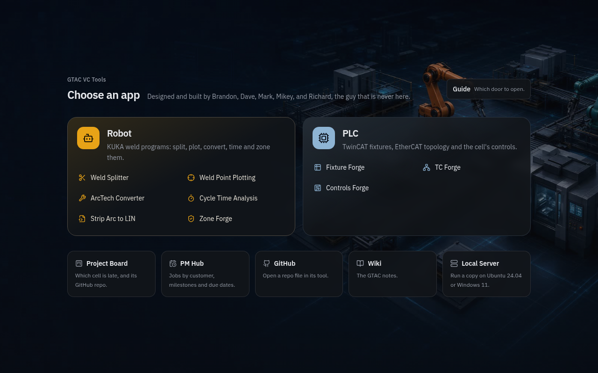

- [Home](#home)
- [Inside a tool](#inside-a-tool)
- [Robot](#robot)
  - [Weld Splitter](#weld-splitter)
  - [Weld Point Plotting](#weld-point-plotting)
  - [ArcTech Converter](#arctech-converter)
  - [Cycle Time Analysis](#cycle-time-analysis)
  - [Strip Arc to LIN](#strip-arc-to-lin)
  - [Zone Forge](#zone-forge)
- [PLC](#plc)
  - [Fixture Forge](#fixture-forge)
  - [TC Forge](#tc-forge)
  - [Controls Forge](#controls-forge)
- [Project Board](#project-board)
- [PM Hub](#pm-hub)
- [GitHub](#github)
- [Wiki](#wiki)
- [Local Server](#local-server)
- [Framework trim](#framework-trim)

## Home

- **Robot** (weld theme): Weld Splitter, Weld Point Plotting, ArcTech Converter, Cycle Time Analysis, Strip Arc to LIN, and Zone Forge. Click the Robot heading to open Weld Splitter.
- **PLC** (TwinCAT theme): Fixture Forge, TC Forge, and Controls Forge. Click the PLC heading to open Fixture Forge.
- **Bottom row**: Project Board, PM Hub, GitHub, Wiki, and Local Server.

Each tool name is a link, so it can open in a new tab. Guide at the top right says which tool fits the job. Click it again to close it.

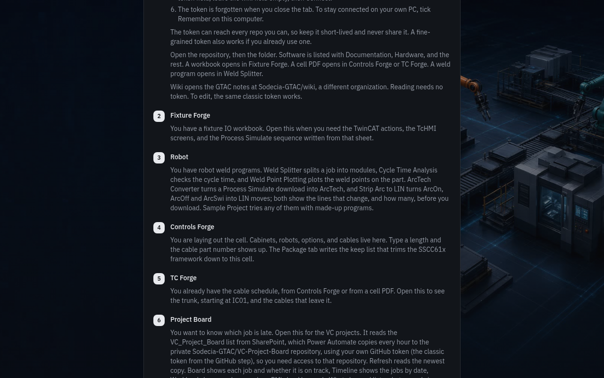

Opening the weld app lands on Weld Splitter.

A bookmark such as ?app=weld, ?app=fixture, ?app=network, ?app=controls, ?app=zones, or ?app=board opens that tool. ?app=weld without a screen opens Weld Splitter.

## Inside a tool

Every tool has the same header. Home and the section drop-down are on the left. Change log, Clear saved work, GitHub, and Wiki are on the right.

The drop-down shows the section and the tool you are in, such as ROBOT, Weld Splitter. Hover over it, or click or tap it, to switch to another tool in that section. Go to PLC or Go to Robot at the bottom jumps to the other section. The keyboard works too: Enter or the down arrow opens it, the arrows move, and Escape closes it.

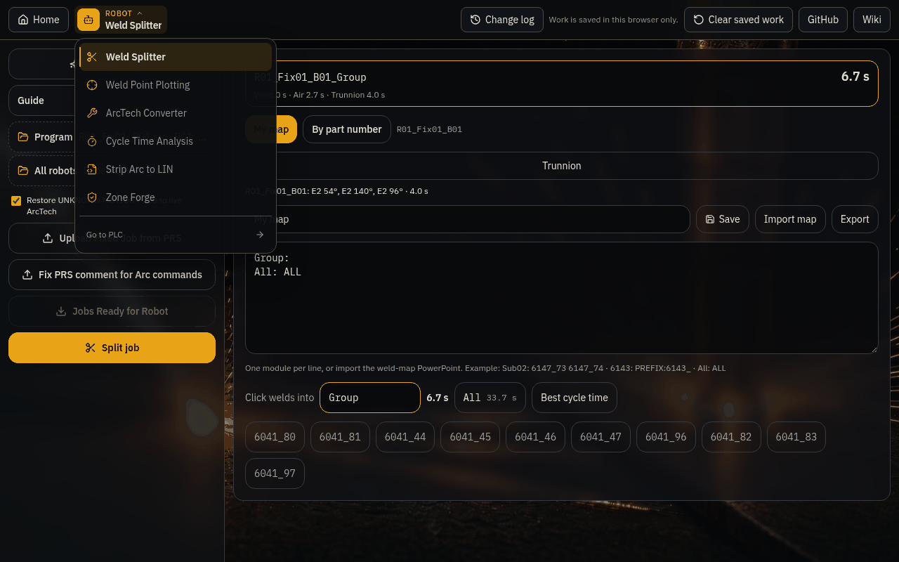

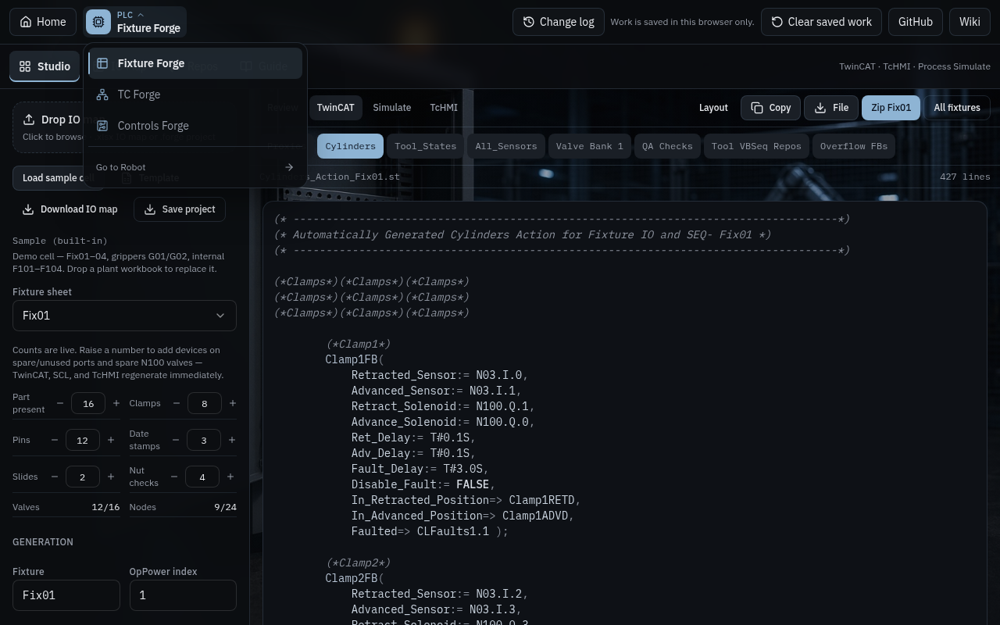

- **Guide**: Weld tools, Zone Forge, Fixture Forge, TC Forge, and Controls Forge each have their own Guide. Click it again to close it.
- **Sample data**: The weld tools have Sample Project on the left. It loads the Front Bumper programs and that weld map. Click it again to clear it. Loading your own .src or zip turns the sample off. On Weld Point Plotting the sample also shows a made-up part. Zone Forge has its own Sample Project, a made-up two-robot cell. Fixture Forge has Load sample cell and Controls Forge has Load sample. The weld and Zone Forge samples are made up, not a real job.
- **Change log**: the clock button lists what changed in that tool and when: Robot tools, Fixture Forge, Project Board, PM Hub and Zone Forge each have one. It opens without a password.
- **Saved work**: Work is saved in this browser only. It is still there after a refresh, but not on another PC or in another browser. Clear saved work resets that tool in this browser and cannot be undone.

## Robot

KUKA weld programs: split, plot, convert, time, and zone them. A weld program from GitHub (src, dat, zip, or pptx) opens in Weld Splitter.

The weld tools share the panel on the left (Sample Project, Guide, Program, and All robots) and one saved work. Weld Point Plotting does not use Program or All robots.

### Weld Splitter

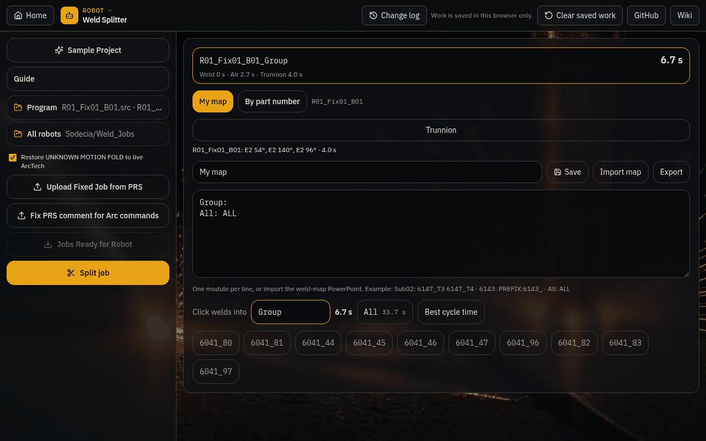

Group welds into modules and download the KUKA programs.

Drop the program .src and the positions .dat on Program. Both can go in at once. All robots takes one or more controller backup zips. If a zip has Sodecia/Weld_Jobs, only the programs in that folder are used.

My map is one module per line. Import map reads a weld-map PowerPoint or a JSON file you exported earlier. By part number skips the map and makes one module per weld family, plus All. Split job, then Download zip. Best cycle time keeps the order with the shortest travel between welds. Click Trunnion when the cell has a KP1 or KP3.

After you fix points in simulation, Upload Fixed Job from PRS takes the Process Simulate file that still has the UNKNOWN MOTION FOLD lines, plus its .dat. Fix PRS comment for Arc commands turns the commented arc lines back into ArcTech. Jobs Ready for Robot saves the corrected files.

### Weld Point Plotting

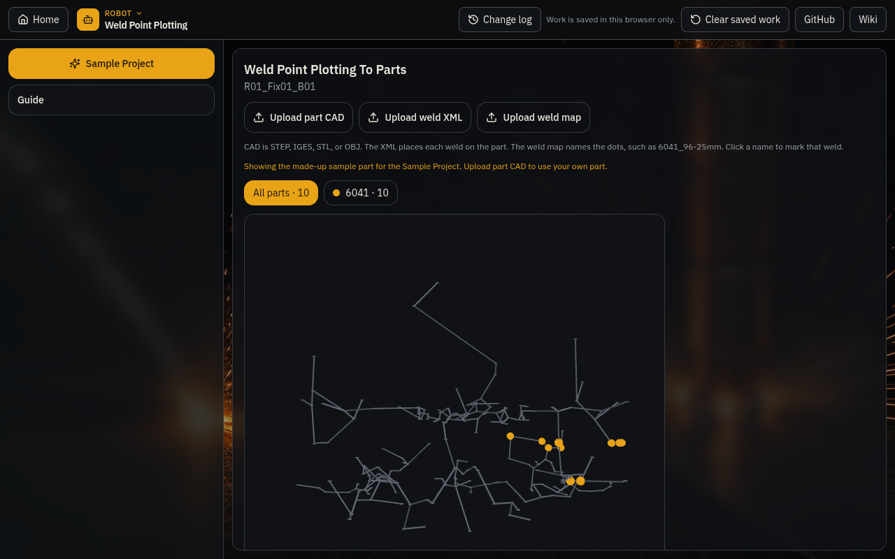

Plot the weld points onto the part each weld belongs to. With Sample Project on, a made-up frame shows with the sample weld points on it, and a line says it is the sample part; your own upload replaces it. Upload part CAD takes a STEP, IGES, STL, or OBJ. Upload weld XML places each weld on the part. Upload weld map is the PowerPoint that labels each dot. Click a name in the list to mark that weld. Drag to rotate.

The part is saved in this browser for the program that is loaded, so each project keeps its own part. It comes back after a reload, and a note under the buttons says so. A part can be up to 200 MB. A bigger file still shows, but has to be uploaded again after a reload. Like other saved work, it is not on another PC or in another browser.

If you uploaded a part before Oct 29, upload it again once.

The weld dots show only on a part that has loaded. A weld XML on its own does not show dots until the part is loaded.

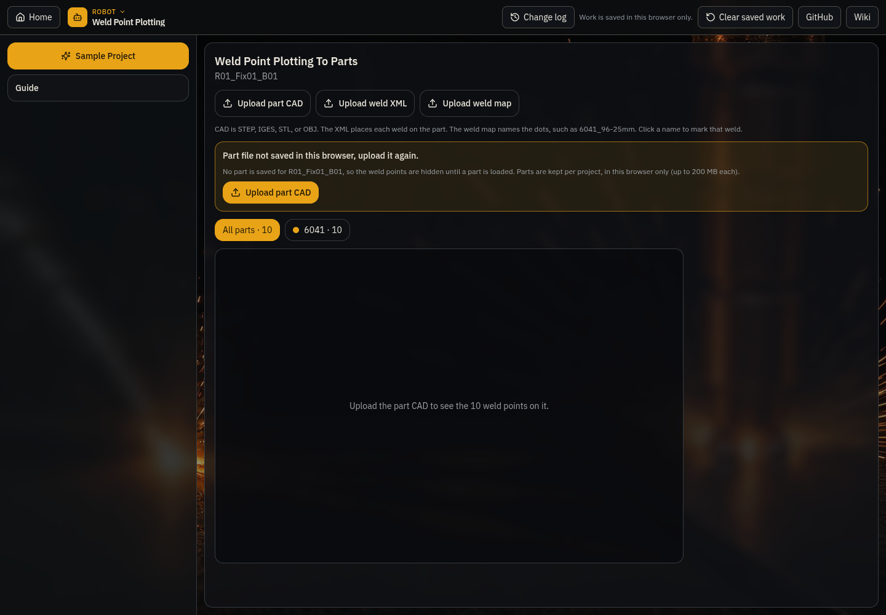

- **No part:** the plot area says Upload the part CAD to see the N weld points on it. The banner says what is missing: Load a program first, No part uploaded yet for the program, or that a part uploaded before is no longer in this browser (or was too big to keep), with an Upload part CAD button. Without the weld XML it adds that the dots use robot coordinates. If a part is saved for another project, a Use button offers it.
- **Loading:** the plot area says Loading the saved part… until the part is read. A STEP or IGES file is read in the background with a progress line (Downloading the STEP reader… the first time, then Reading the STEP file…), so the page stays usable.
- **The part could not be shown:** the plot area stays empty and the banner gives the reason, with no dots. Try a STEP (AP214 or AP242) or STL export and upload it again. A file that does not load is not saved, so a good part saved earlier is kept.
- **Weld points are not on the part:** their X Y Z come from the robot program. Upload the weld XML to place them on the part.

The view frames the part and the weld points together. Clear saved work also clears the saved parts. STEP and IGES parts load on the Local Server too.

### ArcTech Converter

Turn a Process Simulate download into ArcTech. Load one job, or Upload jobs for a zip or several .src files. UNKNOWN MOTION FOLD comes back as ArcOn, ArcSwi, and ArcOff. The .dat is not changed.

Before Download, each program's changed lines show, removed in red and added in green, with the count under Download, such as 320 lines added. Open a program's section to see its lines; long lists show the first 30 changes and Show all.

### Cycle Time Analysis

Seam and travel time from the weld map and the programs. Upload weld map and choose the PowerPoint. The seam time uses the millimetres on each weld label, such as 6041_96-25mm, divided by the weld speed. Load the program and the .dat on the left for a second table that adds travel between the points. Download analysis saves the tables as an Excel file. Blending and acceleration are not included, so a real cycle runs a bit longer.

### Strip Arc to LIN

Turn ArcOn, ArcOff, and ArcSwi into LIN moves. Load one .src and .dat, or Upload jobs zip for several. ArcOn and ArcOff become a fine LIN at 0.01 m/s. ArcSwi stays a LIN with C_DIS. A comment such as ; was ARCON WDAT1 marks each line so the arc can be taught again on the robot. The .dat files are not changed.

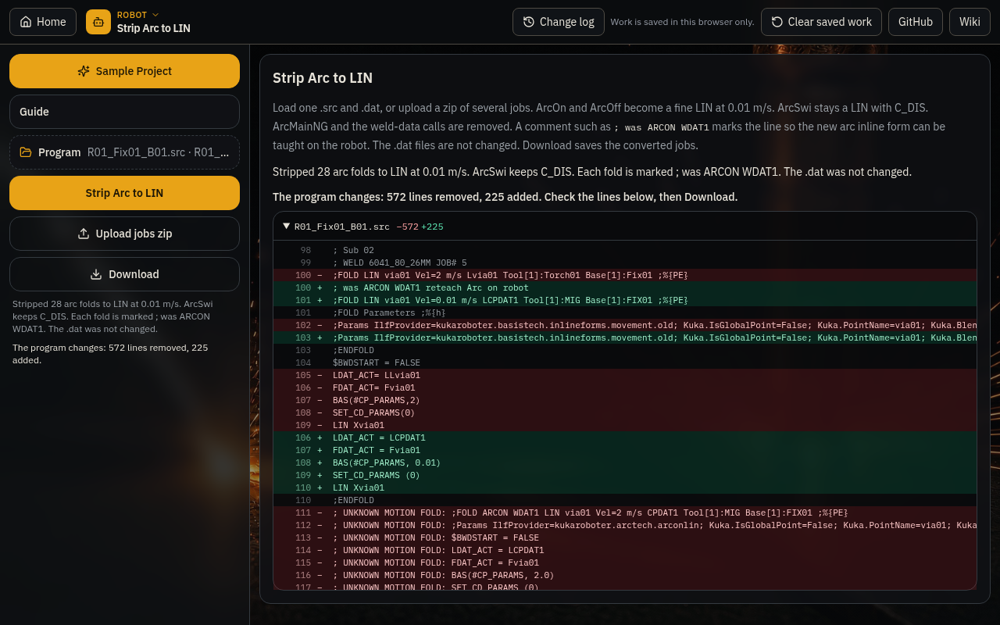

Before Download, each program's changed lines show, removed in red and added in green, and the count shows under Download, such as 572 lines removed, 225 added. If nothing changes it says so: Download would give back the same files.

### Zone Forge

Fill in the interference-zone handshakes. Drop the KUKA programs and their .dat files, with the same name for both, such as R01_Fix01.src and R01_Fix01.dat. Process Simulate marks the last point before an interference volume and the first point after it.

Pick PLC bits or OLP sync. With PLC bits, assign one bit per pair of robots. 106 is the first pair, and robot interference uses 106 to 112. Bit 105 is the trunnion, or table, turn. Change a number to match the zone on the fixture, check What gets added, then Download the programs.

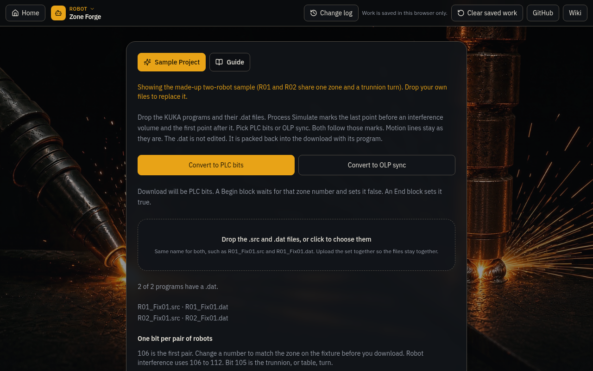

Sample Project loads a made-up two-robot cell (R01_Fix01 and R02_Fix01) to try it; dropping your own programs replaces it. Guide lists the steps. The trunnion settings show only when the programs have trunnion comments; otherwise a line says there are none. When the programs already have every handshake, it says Nothing to change. Download would give back the same files.

## PLC

TwinCAT fixtures, EtherCAT topology, and the cell's controls.

### Fixture Forge

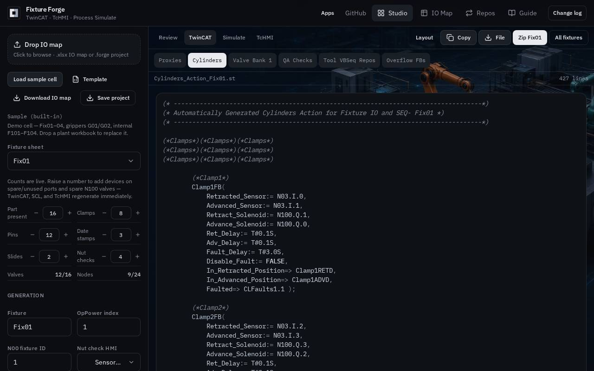

Open this when you have a fixture IO workbook. It writes the TwinCAT actions, the TcHMI screens, and the Process Simulate sequence from that sheet.

Drop the Excel map, or click Drop IO map and browse. Pick the fixture sheet. Copy the output into the matching POU or editor.

Workbook columns the generator reads:

- J / K — node (N01–N24) and port 0–7
- L / M — address (N01.I.0) and the description of use
- AC / AD — sequence of operation: step number and the action (Close, Open, Adv, Ret, grouped by model)

Sequence packs as part present, then clamps, pins, slides, and nut checks. Each new device type starts on port 0 of the next node. If a group ends on ports 0–6, the rest of that node is spare. Unused hardware is tagged Node Not Used.

On the TcHMI page, the Layout tab is where devices are placed on the fixture picture: Sample fixture or Upload image, then click where each arrow points. On a phone the text sits above the buttons. For the code files, Preview and Source switch between the drawn screen and the code. The layout can take the whole window. The left panel and the top band slide away. Click the arrow to bring them back. A screen you added can be deleted. The objects that were placed on it clear, so they can be placed again.

A fixture workbook from GitHub opens in this app.

### TC Forge

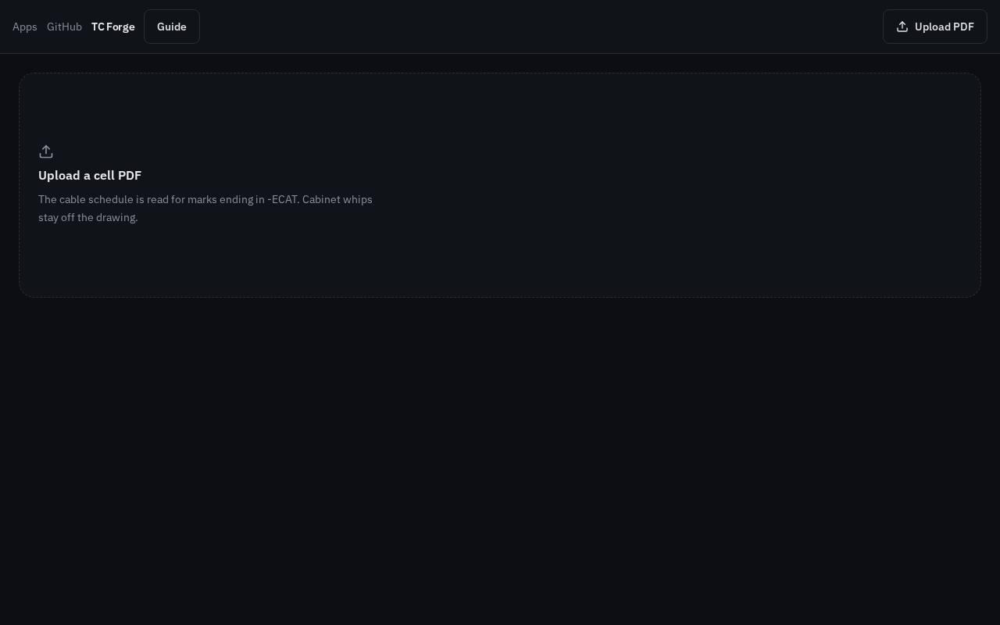

Open this when you already have the cable schedule, from Controls Forge or from a cell PDF. It draws the trunk, starting at IC01, and the cables that leave it.

Upload the cell PDF. The topology always starts at IC01. Download the drawing when you need a copy.

### Controls Forge

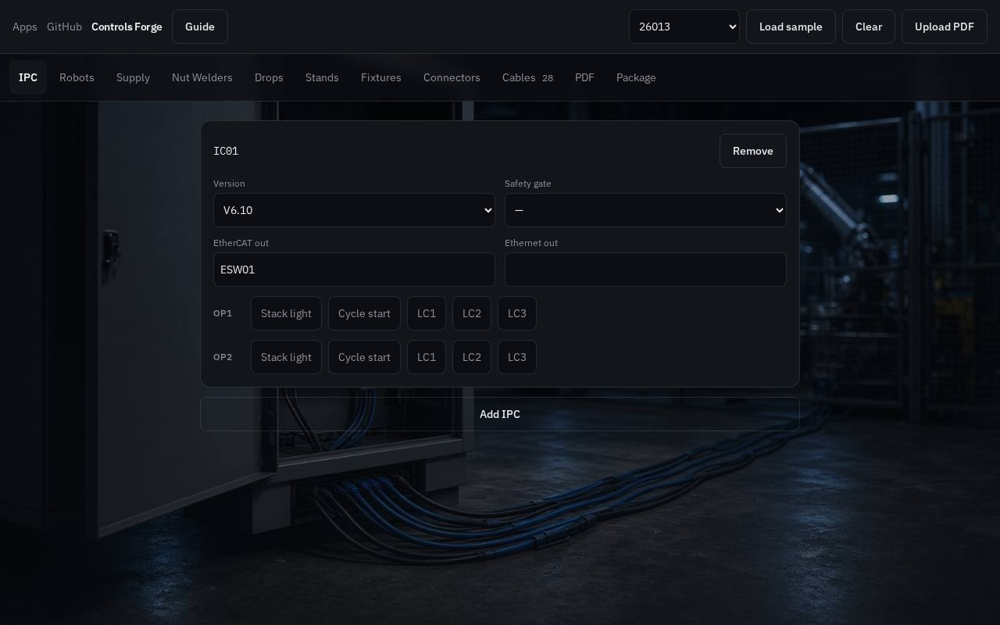

Open this when you are laying out the cell. Cabinets, robots, options, and cables live here. Type a length and the cable part number shows up. The Package tab writes the keep list that trims the SSCC61x framework down to this cell.

#### Start a cell

Pick a project in the sample list and click Load sample. That fills the tabs from a real cell. Upload PDF does the same from a cable schedule: marks that end in -ECAT become the devices, the links, and the lengths. Clear puts the form back to empty.

If the PDF or the sample has no cell number on the end, the app asks for it before the serial is finished.

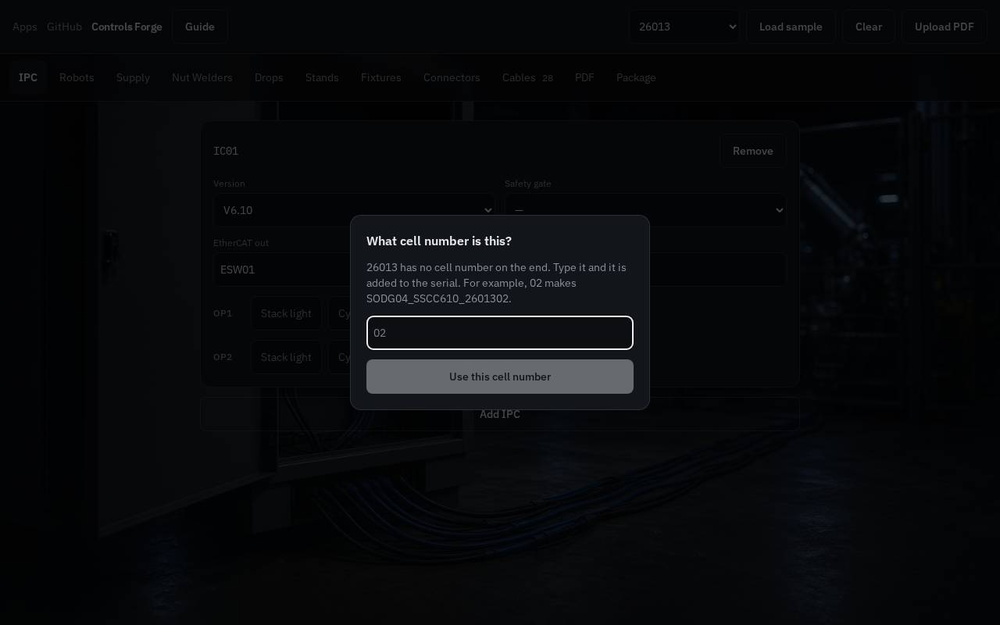

#### Tabs

IPC holds the version, the safety gate, and where EtherCAT and Ethernet leave. Operator rows turn on the stack light, cycle start, and light curtains. Robots take the cabinet, the arm, the welder, and the reamer. Supply, nut welders, drops, stands, and fixtures are the rest of the chain. Connectors lists the plug on each cabinet. EtherCAT out is the next device.

#### Cables

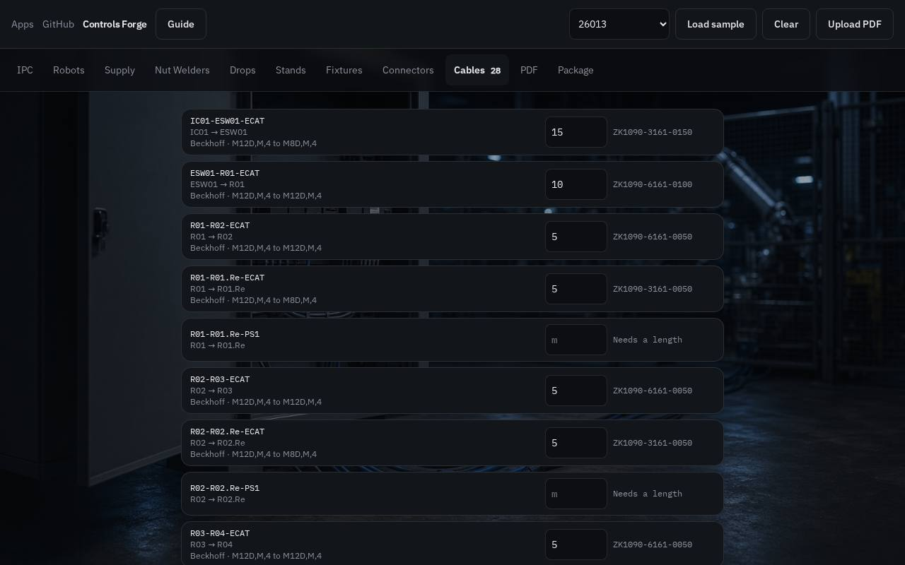

Cables lists every link the tabs describe. The connectors are already known from the devices. Type the length in meters and the part number comes from the lookup, including the maker and the connectors on the cable. No length yet means the cable is still waiting.

#### Topology PDF

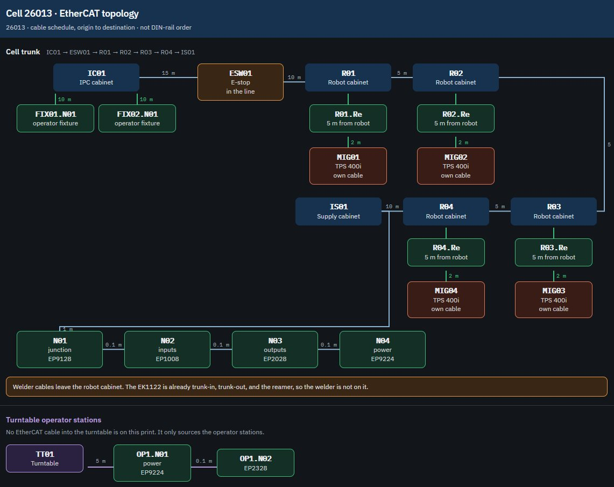
<!-- topology-drawing-v4 -->
PDF draws the EtherCAT trunk, starting at IC01, with the drops beside it. When the row hits the right side it continues on the left as another row. Download PDF puts that drawing on the first page and the cable list after it. TC Forge reads the marks that end in -ECAT.

A cell PDF from GitHub can open here or in TC Forge.

## Project Board

Which cell is late, who is loaded, and its GitHub repo. Red (At risk) is late or has less time left than work left. Yellow (Tight) is due within 14 days. Blue (On track) still has room.

The board reads the VC_Project_Board list from the private VC-Project-Board repository on GitHub, using the GitHub token connected in this browser. Refresh reads it again. If GitHub cannot be read, the last copy stays on screen, and Drop export under More works too.

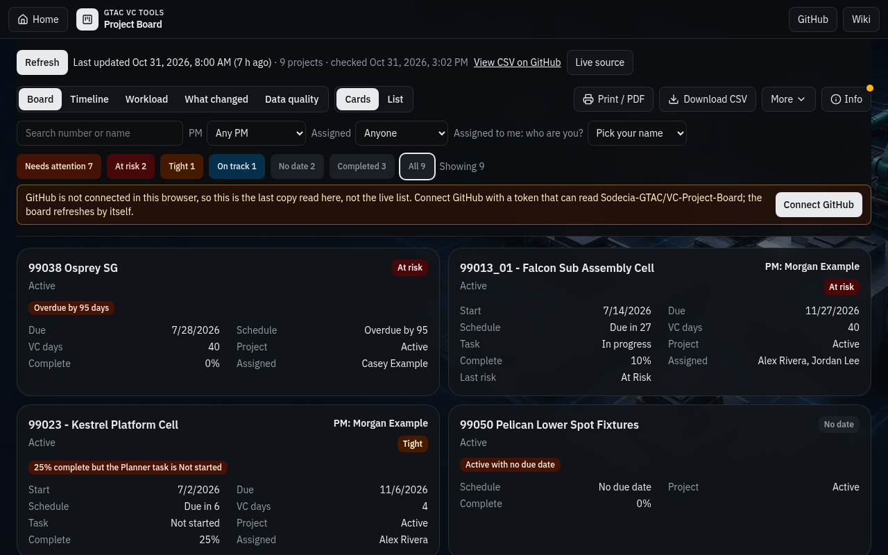

Without a GitHub token, an amber line under the header says the board is not connected and whether it is showing the last copy read in this browser, with a Connect GitHub button. Once the token is saved the board reads the live list by itself. While a dropped export is showing, the line says so, with Back to live.

Search, PM, Assigned and Assigned to me narrow the jobs. The chips are Needs attention, At risk, Tight, On track, No date, Completed and All.

### Screens

- **Board**: cards, or a compact list with one row per job.
- **Timeline**: a bar per job from Start to Due, filled to % complete, with a line for today. Group by none, PM or assigned person. Jobs with no due date are not on it.
- **Workload** (?view=workload): VC days still to do for the next 8 weeks, per person or per PM. Capacity is 5 days a week. Over 5 is red, 4 to 5 is amber. Late jobs are in an Overdue column before the first week, and Total includes them. A week under 1 day shows as a faint dot. It counts in Total and can be clicked. Click a number to list that week's jobs. Jobs with no due date or no VC days cannot be placed; the count links to Data quality.
- **What changed**: new and removed jobs, moved dates, status and % changes, and jobs newly overdue or at risk, since your last visit, or 7 or 30 days ago.
- **Data quality** (?view=quality): every job with a data problem, grouped by PM, each with a Fix in Planner or Fix in SharePoint line. It shrinks as the list is cleaned up.

### Job details

Click a job name on a card, list row, timeline bar, Data quality entry or Workload week. A panel opens with every field, the Plan, GitHub and SharePoint links, the job's data problems with the fix, and its last changes. The address gets ?job=. Close, Esc or Back returns to the view. On a phone it opens full screen.

The repository name, Save repository and Open GitHub are only in this panel. A card shows a GitHub button when the job has a repository.

When the PM Hub customer list can be read, the panel also has a read-only Customer line. The name opens that customer in PM Hub.

### Buttons

- **Print / PDF** prints the current view. Save as PDF works. The header names the view, the filters and the data time.
- **Download CSV** saves the jobs shown, with the columns the board shows.
- **More** holds SharePoint list, Drop export and Drop OneNote. Drop export takes a newer CSV or Excel export. Drop OneNote updates the fixture reviews. Dropping a file anywhere on the board works too.
- **Info** holds the notes about where the data comes from, the fixture reviews, and GitHub not being connected. A dot on Info means there is a notice.

## PM Hub

For the production managers. Open PM Hub on Home, next to Project Board, or go to ?app=pmhub. It uses the same jobs and the same GitHub token as the Project Board.

### Projects

Jobs grouped by customer, with No customer set last. Each job shows its customer, status, PM, due date, days left or late, a small start-to-due bar with milestone markers, and the next milestone. Filter by PM, customer, search and status (Open, Overdue, Due soon, At risk, No date, Completed, All). Due soon can be 7, 14 or 30 days.

Click a job to open its details. Start and Due come from SharePoint; change those dates there. Add milestone adds your own, such as Design review, Fixture buy-off or Ship. Tick a milestone when it is done. The PM note is also here. Open in Project Board opens the same job on the board.

### Timeline

Looks and works like the board's Timeline. Group by Customer, PM or None. PM milestones show as diamonds on the bars: red overdue, amber due soon, filled done.

### Milestones

Every milestone in the filters, by date: Overdue, Due soon, Upcoming, No date, and Done (folded).

### Customers

The shared customer list. Add customer, or click one to edit it: name, short code, main contact (name, email, phone) and notes. A customer is deactivated rather than deleted. Delete is only offered when it has no jobs.

Link jobs to a customer in three ways:

- pick the jobs from the list;
- by job number. A base number covers every job with it, and a full number covers that one job;
- by keyword in the job name or machine description.

A picked job wins over a job number, and a job number wins over a keyword. A job that matches two customers shows an amber Also matches warning. Fix it in one of the customers.

Each job in PM Hub also has a Customer picker: assign or change it for this job only or all jobs with that number, clear it, or make a new customer.

The list is saved to pm-hub/customers.json in the private Sodecia-GTAC/VC-Project-Board repository, so both PMs see the same list. Others see a change after Refresh. If someone else saved first, PM Hub reloads the list, keeps what you typed, and asks you to Save again.

### Shared milestones and notes

Milestones, ticks and PM notes are shared with the team in pm-hub/milestones.json in the same repository. They are saved a few seconds after a change, or with Save. If two people change the same job, PM Hub merges what it can and asks you to Save again. Without Write access they stay in this browser until they can be saved. Export saves them (and a copy of the customer list) to a file. Import puts them back.

When the Timeline has nothing to show, it says why (the No date filter, completed jobs hidden, or no dated jobs) with Show open jobs or Clear filters.

### Status emails

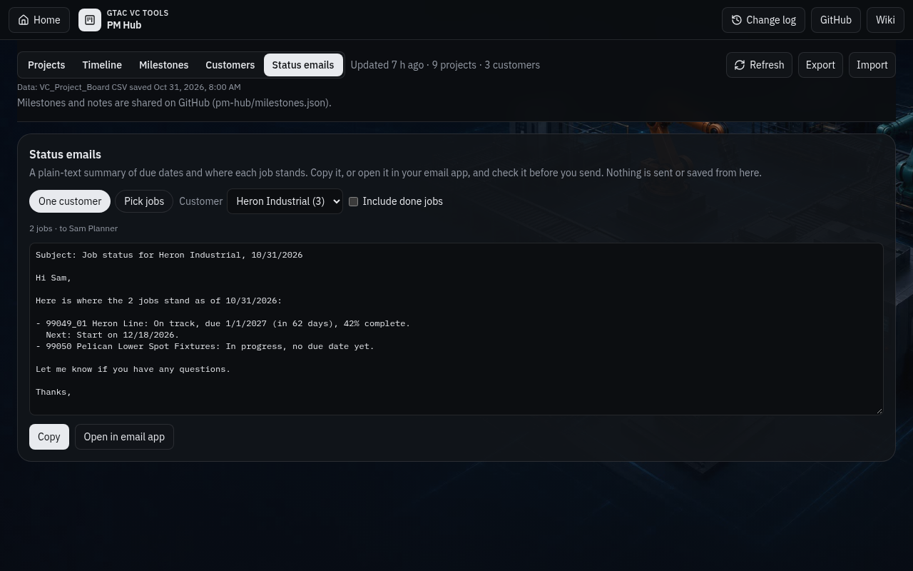

Status emails (?view=email) writes a plain-text update to send to a customer. Choose One customer and pick the customer, or Pick jobs and tick them. The text has a subject, a greeting with the customer's main contact, and one line per job: its status (Done, Behind schedule, At risk, Due soon or On track), due date, days left or late, % complete and the next milestone. Done jobs are left out unless Include done jobs is ticked.

Copy puts the text on the clipboard. Open in email app opens your own email program with it, addressed to the customer's contact email; a very long update opens with the subject only, so copy the text in. Read it before you send. Nothing is sent or saved from PM Hub.

### Access

You need your classic GitHub token (repo scope), authorized for SSO; see [GitHub](#github). To save customers, milestones and notes for everyone you also need Write access to VC-Project-Board. Ask Dave. Without it, the Customers tab is read-only and milestones stay in your browser.

## GitHub

GitHub is how a project gets into the app. The cell projects live in the organization https://github.com/Sodecia-GTAC-Machines.

There is no app login, name picker, or app 2FA code. Your own GitHub token is the key, and GitHub decides what it can see.

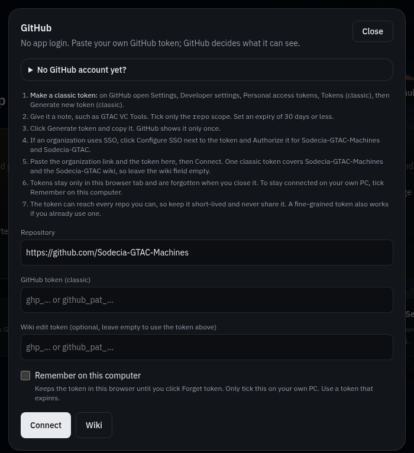

### No GitHub account yet?

1. Go to https://github.com/signup. Enter your work email, a password and a username your teammates will recognise, then solve the check.
2. Enter the code GitHub emails you to verify your email.
3. Turn on two-factor authentication: profile picture, Settings, Password and authentication, Enable two-factor authentication. The organizations may require it before you can join.
4. Send your GitHub username to Dave Bergman or your team lead and ask to be invited to the Sodecia-GTAC-Machines and Sodecia-GTAC organizations, and to the VC-Project-Board repository for the Project Board and PM Hub. Dave is an admin of both organizations, so the invitation comes from him or your team lead.
5. Accept each invitation from the email, or at https://github.com/orgs/Sodecia-GTAC-Machines/invitation and https://github.com/orgs/Sodecia-GTAC/invitation. Invitations expire after 7 days.
6. Then make your classic token below.

### Token

Make one classic token on GitHub. It covers Sodecia-GTAC-Machines and the Sodecia-GTAC wiki.

1. On GitHub open Settings, Developer settings, Personal access tokens, Tokens (classic), then Generate new token (classic).
2. Give it a note, such as GTAC VC Tools.
3. Tick only the repo scope.
4. Set an expiry of 30 days or less.
5. Click Generate token and copy it. The value is shown once. It starts with ghp_.
6. If an organization uses SSO, click Configure SSO next to the token and Authorize it for Sodecia-GTAC-Machines and Sodecia-GTAC.

The token can reach every repo you can, so keep it short-lived and never share it. A fine-grained token also works if you already use one.

### Connect

1. Click GitHub.
2. Paste https://github.com/Sodecia-GTAC-Machines in Repository. The address has to be real text in the box, not the gray hint.
3. Paste the token in GitHub token (classic).
4. Leave Wiki edit token empty. The same token is used for the wiki.
5. Optional: tick Remember on this computer, only on your own PC.
6. Click Connect.

Tokens stay only in that browser tab and are forgotten when the tab closes, unless you ticked Remember on this computer. Forget token clears them sooner.

If GitHub refuses the token, the panel says why. For SSO, authorize the token with Configure SSO.

### Projects

The organization link lists the repositories. Search filters that list. Download on a repository saves the whole repo as a zip.

Open a repository, then a folder. Software is listed with Documentation, Hardware, and the rest. Download on a file saves that file, including files that do not open in an app.

- A workbook opens in Fixture Forge.
- A cell PDF opens in Controls Forge or TC Forge.
- A weld program opens in Weld Splitter.

## Wiki

Wiki opens this repository, Sodecia-GTAC/wiki, full screen. It starts on the README table of contents. Folders still lists the drawers. Search needs at least two letters and matches notes and headings. Reading needs no token.

Edit opens the markdown for the page you are on. Save commits it to main. New page asks for a path, such as Instructions/New note.md, then commits that file. Cancel throws the change away.

Saving uses your classic GitHub token (repo scope), since the Wiki edit token field is left empty.

## Local Server

Run a copy on Ubuntu 24.04 Desktop or Windows 11. Local Server shows the download, vc-tools-local.zip, and the install steps for each system. It needs no password. A publish does not change a Local Server that is already running. Download the zip again and follow When the app changes.

## Framework trim

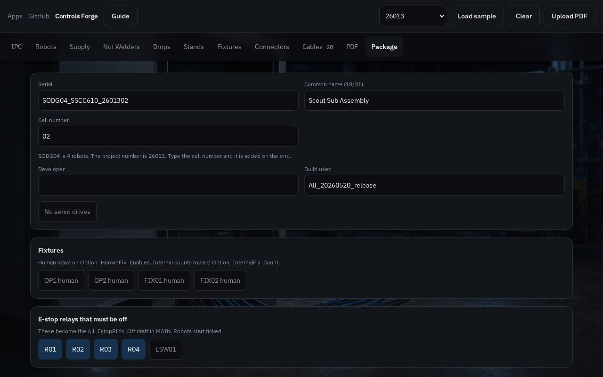

The Package tab in Controls Forge writes the keep list. The scripts trim a copy of the SSCC61x framework down to that cell. Robot count can change from job to job. Do not hard-code a cell size.

### Serial

The serial is filled in on Package. SODG and two digits is the robot count. SSCC610 is the framework. The project number plus the cell number is the end. Four robots on 26013 cell 02 becomes SODG04_SSCC610_2601302.

### One folder for the trim kit

On the PC, make one folder and keep it outside the TwinCAT project. Documents\\PLC Trimming is fine. Download these five files from the Package tab into that same folder. The batch file only looks beside itself, so they have to stay together.

- Run-FwTrim.bat
- Pick-TrimPaths.ps1
- Prune-IoAndPlc.ps1
- Prune-SafetyXML.ps1
- CellKeep.ps1

Leave the framework where it already is. After the first run, last-trim.txt in the trim folder remembers both paths. When a script changes, replace the file in this folder. Do not keep an old copy next to the new one.

### Run it

1. Save the trim kit once, then double-click Run-FwTrim.bat.
2. Pick the keep list, then the folder that contains the .tsproj.
3. Leave one TwinCAT window open on that solution, with no dialogs. Two open projects are refused. If the open solution is a different serial than the keep list, the trim stops. An untouched framework is allowed through so it can be renamed.
4. The script renames the solution, the TwinCAT project, and the PLC project to the serial. A stray second solution file from the template name is removed.
5. The I/O prune removes EtherCAT devices that are not in the keep list. If the cell has no servos, it disables NC-Task 1 SAF and then removes that task. The rest of MOTION stays.
6. Close TcXaeShell when the batch file says to. The next script unlinks safety projects that are not in the keep list and deletes those folders. It writes GTAC_CONFIG and All_EstopRLYs_Off. It does not change .sal, .sds, or .diagram files.

### Finish safety by hand

Reload the solution, then:

1. In IC01.T02.EL6900, delete ST_Decouples only if this cell has no stud welder.
2. Delete IC_Decouple only if this cell has no extra controller. Otherwise leave it.
3. In Robot_Decouple, delete the red blocks for robots that are not in this cell.
4. Deactivate the unused inputs.
5. Run Verify Complete Safety Project.
