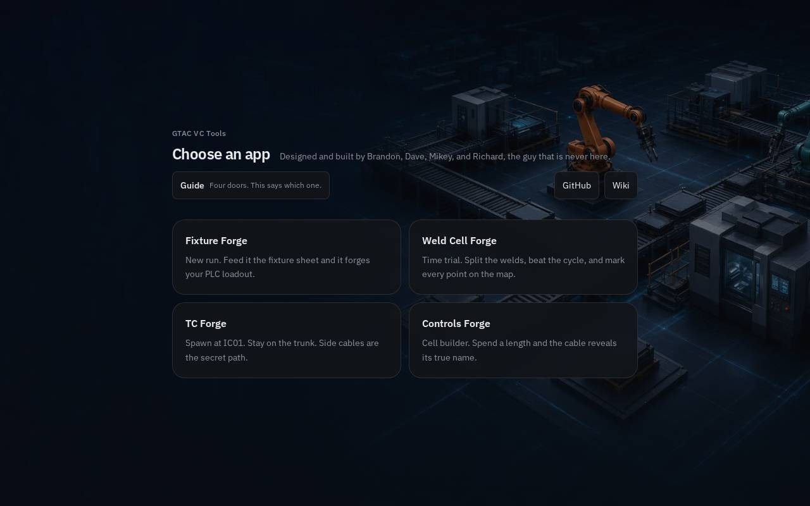
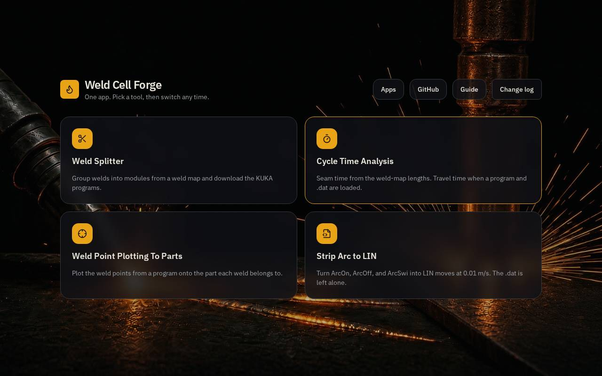
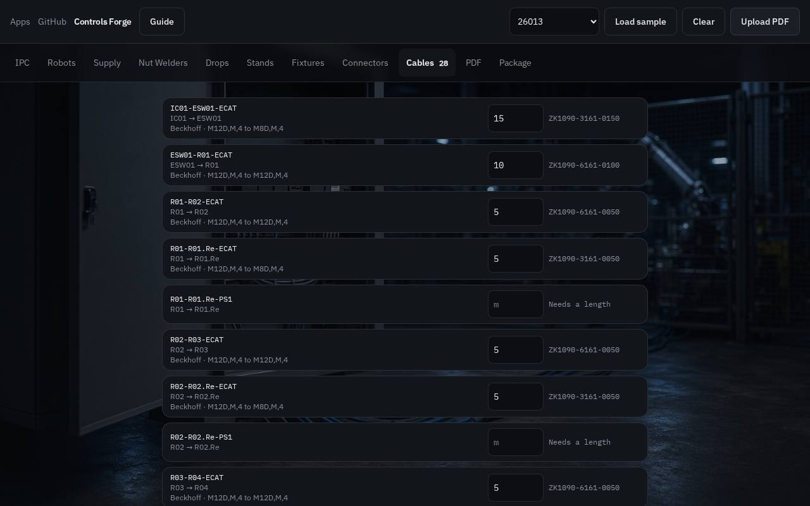

# GTAC VC Tools

GTAC VC Tools is the shop app for laying out a cell, trimming the SSCC61x framework, drawing the EtherCAT trunk, and generating fixture and weld outputs.

Designed and built by Brandon, Dave, Mikey, and Richard, the guy that is never here.

There are four apps. GitHub and the wiki sit beside them.

- [Fixture Forge](#fixture-forge)
- [Weld Cell Forge](#weld-cell-forge)
- [Controls Forge](#controls-forge)
- [TC Forge](#tc-forge)
- [GitHub](#github)
- [Wiki](#wiki)
- [Framework trim](#framework-trim)

## Fixture Forge

Open this when you have a fixture IO workbook. It writes the TwinCAT actions, the TcHMI screens, and the Process Simulate sequence from that sheet.

Drop the Excel map, or click Drop IO map and browse. Pick the fixture sheet. Copy the output into the matching POU or editor.

Workbook columns the generator reads:

- J / K — node (N01–N24) and port 0–7
- L / M — address (N01.I.0) and the description of use
- AC / AD — sequence of operation: step number and the action (Close, Open, Adv, Ret, grouped by model)

Sequence packs as part present, then clamps, pins, slides, and nut checks. Each new device type starts on port 0 of the next node. If a group ends on ports 0–6, the rest of that node is spare. Unused hardware is tagged Node Not Used.

On the TcHMI page, the layout can take the whole window. The left panel and the top band slide away. Click the arrow to bring them back. A screen you added can be deleted. The objects that were placed on it clear, so they can be placed again.

A fixture workbook from GitHub opens in this app.

## Weld Cell Forge

Open this when you have robot weld programs. Split a job into modules, check the cycle time, or plot the weld points on the part.

A weld program from GitHub (src, dat, zip, or pptx) opens in this app.

## Controls Forge

Open this when you are laying out the cell. Cabinets, robots, options, and cables live here. Type a length and the cable part number shows up. The Package tab writes the keep list that trims the SSCC61x framework down to this cell.

### Start a cell

Pick a project in the sample list and click Load sample. That fills the tabs from a real cell. Upload PDF does the same from a cable schedule: marks that end in -ECAT become the devices, the links, and the lengths. Clear puts the form back to empty.

If the PDF or the sample has no cell number on the end, the app asks for it before the serial is finished.

### Tabs

IPC holds the version, the safety gate, and where EtherCAT and Ethernet leave. Operator rows turn on the stack light, cycle start, and light curtains. Robots take the cabinet, the arm, the welder, and the reamer. Supply, nut welders, drops, stands, and fixtures are the rest of the chain. Connectors lists the plug on each cabinet. EtherCAT out is the next device.

### Cables

Cables lists every link the tabs describe. The connectors are already known from the devices. Type the length in meters and the part number comes from the lookup, including the maker and the connectors on the cable. No length yet means the cable is still waiting.

### Topology PDF

PDF draws the EtherCAT trunk, starting at IC01, with the drops beside it. When the row hits the right side it continues on the left as another row. Download PDF puts that drawing on the first page and the cable list after it. TC Forge reads the marks that end in -ECAT.

A cell PDF from GitHub can open here or in TC Forge.

## TC Forge

Open this when you already have the cable schedule, from Controls Forge or from a cell PDF. It draws the trunk, starting at IC01, and the cables that leave it.

Upload the cell PDF. The topology always starts at IC01. Download the drawing when you need a copy.

## GitHub

GitHub is how a project gets into the app. The cell projects live in the organization https://github.com/Sodecia-GTAC-Machines.

### Sign in

Click GitHub. Pick your name: Dave, Brandon, Mikey, or Richard. The first time, scan the code into your authenticator and name the entry GTAC VC Tools. Enter that 6-digit code.

This is a second entry in the same authenticator app. The code from GitHub's own site will not open the app. Closing the browser asks for the code again. The organization link and the token stay on that computer.

### Token, once per browser

On GitHub open Settings, Developer settings, Personal access tokens, Tokens (classic). Generate a new token (classic). Check only the repo box. GitHub asks for its own 2FA on that page. Copy the value that starts with ghp_. It is shown once.

Paste https://github.com/Sodecia-GTAC-Machines and that token, then Connect. The address has to be real text in the box, not the gray hint.

### Projects

The organization link lists the repositories. Search filters that list. Download on a repository saves the whole repo as a zip.

Open a repository, then a folder. Software is listed with Documentation, Hardware, and the rest. Download on a file saves that file, including files that do not open in an app.

- A workbook opens in Fixture Forge.
- A cell PDF opens in Controls Forge or TC Forge.
- A weld program opens in Weld Cell Forge.

## Wiki

Wiki opens this repository, Sodecia-GTAC/wiki, full screen. It starts on the README table of contents. Folders still lists the drawers. Search needs at least two letters and matches notes and headings.

Edit opens the markdown for the page you are on. Save commits it to main. New page asks for a path, such as Instructions/New note.md, then commits that file. Cancel throws the change away.

Saving uses the same GitHub token. It needs the repo scope.

## Framework trim

The Package tab in Controls Forge writes the keep list. The scripts trim a copy of the SSCC61x framework down to that cell. Robot count can change from job to job. Do not hard-code a cell size.

### Serial

The serial is filled in on Package. SODG and two digits is the robot count. SSCC610 is the framework. The project number plus the cell number is the end. Four robots on 26013 cell 02 becomes SODG04_SSCC610_2601302.

### One folder for the trim kit

On the PC, make one folder and keep it outside the TwinCAT project. Documents\\PLC Trimming is fine. Download these five files from the Package tab into that same folder. The batch file only looks beside itself, so they have to stay together.

- Run-FwTrim.bat
- Pick-TrimPaths.ps1
- Prune-IoAndPlc.ps1
- Prune-SafetyXML.ps1
- CellKeep.ps1

Leave the framework where it already is. After the first run, last-trim.txt in the trim folder remembers both paths. When a script changes, replace the file in this folder. Do not keep an old copy next to the new one.

### Run it

1. Save the trim kit once, then double-click Run-FwTrim.bat.
2. Pick the keep list, then the folder that contains the .tsproj.
3. Leave one TwinCAT window open on that solution, with no dialogs. Two open projects are refused. If the open solution is a different serial than the keep list, the trim stops. An untouched framework is allowed through so it can be renamed.
4. The script renames the solution, the TwinCAT project, and the PLC project to the serial. A stray second solution file from the template name is removed.
5. The I/O prune removes EtherCAT devices that are not in the keep list. If the cell has no servos, it disables NC-Task 1 SAF and then removes that task. The rest of MOTION stays.
6. Close TcXaeShell when the batch file says to. The next script unlinks safety projects that are not in the keep list and deletes those folders. It writes GTAC_CONFIG and All_EstopRLYs_Off. It does not change .sal, .sds, or .diagram files.

### Finish safety by hand

Reload the solution, then:

1. In IC01.T02.EL6900, delete ST_Decouples only if this cell has no stud welder.
2. Delete IC_Decouple only if this cell has no extra controller. Otherwise leave it.
3. In Robot_Decouple, delete the red blocks for robots that are not in this cell.
4. Deactivate the unused inputs.
5. Run Verify Complete Safety Project.
